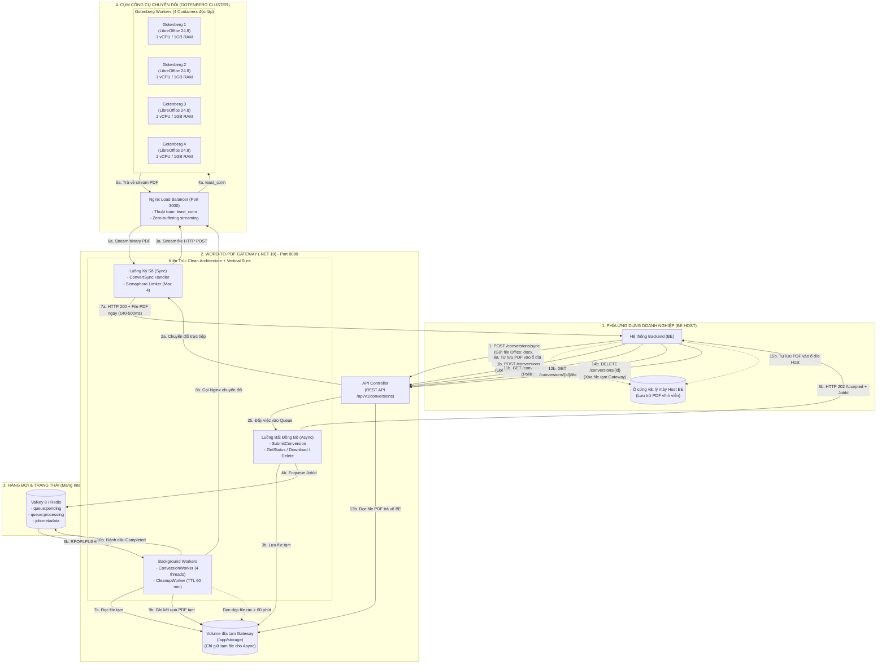
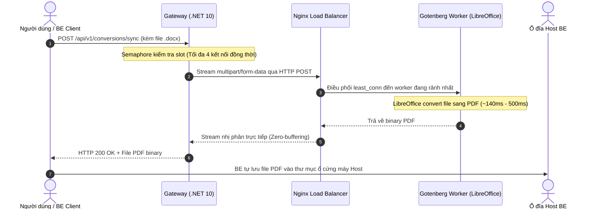
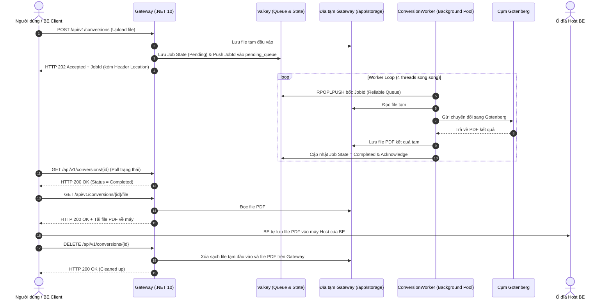

# MÔ HÌNH TỔNG QUÁT HỆ THỐNG WORD-TO-PDF CONVERSION GATEWAY
## (.NET 10 & Gotenberg Cluster Architecture)

---

## 1. Sơ Đồ Kiến Trúc Tổng Thể (System Architecture Topology)

Sơ đồ thể hiện toàn bộ các tầng từ **Phía Backend Khách (BE Host)**, qua **Gateway .NET 10**, đến **Hàng đợi Valkey** và cụm **Gotenberg Cluster**:



---

## 2. Chi Tiết Hai Luồng Nghiệp Vụ Cốt Lõi

### 2.1. Luồng 1: Ký Số Trực Tiếp (Synchronous Flow - Ký Tức Thì)
Dành cho người dùng đang thao tác trên giao diện, cần file PDF trong vòng **vài trăm mili-giây** để ký token / hiển thị xem trước.



> **Đặc điểm**:
> - Không ghi ổ cứng tạm, không đẩy qua Redis Queue.
> - Dữ liệu truyền dạng Stream từ đầu đến cuối, Gateway không bị phình RAM (Zero LOH fragmentation).

---

### 2.2. Luồng 2: Upload Hàng Đợi (Asynchronous Flow - Xử Lý Nền)
Dành cho upload tài liệu lớn (10MB - 100MB), tài liệu nhiều trang hoặc xử lý lô (batch).



---

## 3. Kiến Trúc Mã Nguồn Clean Architecture & VSA (.NET 10)

Mã nguồn được phân tách tuyệt đối thành 4 project:

```
src/
├── ConverterService.Domain/                     # [Tầng 1: Độc lập 100%, chứa Rule nghiệp vụ]
│   ├── Common/                                 # Result<T>, Error
│   └── Conversions/                            # ConversionJob, Value Objects, Domain Errors
│
├── ConverterService.Application/                # [Tầng 2: Vertical Slice Architecture]
│   ├── Abstractions/                           # Interface trừu tượng (IConversionQueue, IDocumentConverter...)
│   └── Features/Conversions/                   # Mỗi chức năng là 1 Vertical Slice khép kín
│       ├── ConvertSync/                        # Slice Ký số (Request, Response, Handler, Validator)
│       ├── SubmitConversion/                   # Slice Tạo Job Async
│       ├── GetConversion/                      # Slice Xem trạng thái Job
│       ├── DownloadConversionResult/           # Slice Tải file PDF
│       ├── DeleteConversion/                   # Slice Xóa dọn dẹp file
│       ├── ProcessConversion/                  # Slice Worker xử lý chuyển đổi
│       └── CleanupOrphans/                     # Slice Thu hồi job mồ côi
│
├── ConverterService.Infrastructure/             # [Tầng 3: Hiện thực kỹ thuật & Hạ tầng ngoài]
│   ├── Gotenberg/                              # GotenbergDocumentConverter, GotenbergHealthCheck
│   ├── Persistence/                            # Redis (Valkey) Queue & Repository, LocalDiskStorage
│   ├── Conversion/                             # SemaphoreConversionSlotLimiter (Rate limiting)
│   └── BackgroundJobs/                         # ConversionWorker (4 pool threads), CleanupWorker (TTL 60m)
│
└── ConverterService.Api/                        # [Tầng 4: Điểm tiếp nhận request REST API]
    ├── Controllers/                            # ConversionsController
    ├── Common/                                 # ApiResponse<T> chuẩn hóa toàn hệ thống
    └── Middleware/                             # GlobalExceptionHandler, ProblemDetails
```

---

## 4. Chú Thích Các Thành Phần Kỹ Thuật

1. **Backend Host (Máy chủ ứng dụng)**:
   - Thay vì nạp DLL Word nặng nề chạy ngốn RAM trên máy chính, BE chỉ gửi 1 request REST API sang Gateway.
   - Khi có kết quả, BE lưu file PDF trực tiếp vào thư mục đĩa cứng của BE. Không cần cài đặt MinIO/S3.
2. **Gateway (.NET 10)**:
   - Điểm trung chuyển duy nhất, expose cổng `8080`.
   - Sử dụng mô hình bộ nhớ Streaming, chỉ tốn **~72 - 89 MB RAM** cho tải hàng trăm MB file nhị phân.
3. **Nginx Load Balancer (`least_conn`)**:
   - Điều phối yêu cầu sang container nào đang ít kết nối nhất. Ngăn chặn triệt để tình trạng một file 15MB làm nghẽn các file nhỏ 50KB.
4. **Cụm 4 Worker Gotenberg (LibreOffice 24.8)**:
   - Tách thành 4 container độc lập tương ứng 4 tiến trình LibreOffice riêng biệt.
   - Cơ chế tự động giải phóng RAM sau mỗi 10 tài liệu, không bao giờ lo LibreOffice rò rỉ bộ nhớ.
5. **Valkey 8 (Redis tương thích)**:
   - Lưu trữ hàng đợi chuyển đổi tin cậy với cơ chế `RPOPLPUSH`. Kể cả khi Gateway bị tắt đột ngột, job không bao giờ bị mất (sẽ được tự động khôi phục khi Gateway bật lại).
