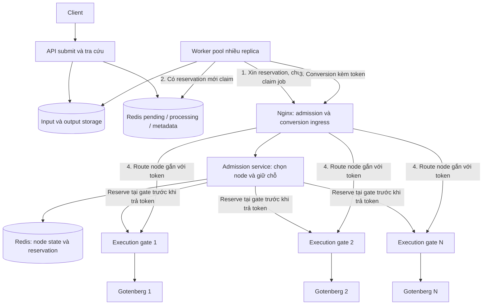
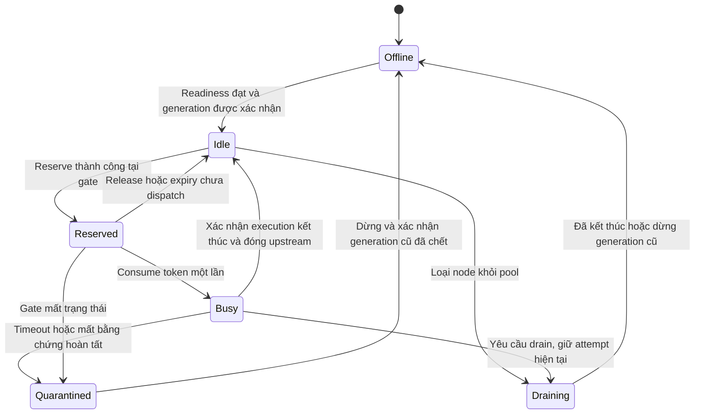

# Kiến trúc Gotenberg: giữ chỗ trước khi lấy job

Trạng thái: đề xuất ngày 2026-11-01; chỉ tài liệu, chưa sửa code hoặc cấu hình triển khai.

## 1. Yêu cầu và hiện trạng

Có N container Gotenberg; từng container chỉ nhận một conversion tại một thời điểm. Nginx chọn container rảnh. Nếu tất cả bận, Worker chờ và job vẫn trong pending queue. Client vẫn có thể submit thêm job vào queue trong giới hạn dung lượng hệ thống.

Đối chiếu repository:

| Thành phần | Hiện trạng quan sát được | Khoảng thiếu |
| --- | --- | --- |
| `Infrastructure/Workers/ConversionWorker.cs` | Dequeue rồi đọc metadata, Start và gọi converter; xử lý tuần tự trong mỗi instance | Chưa giữ capacity trước dequeue |
| `Infrastructure/Queues/RedisConversionQueue.cs` | LPUSH/RPOP; dequeue xóa phần tử khỏi pending | Chưa có claim/ack và phục hồi job đã lấy |
| `Application/Queues/IConversionJobQueue.cs` | Enqueue/Dequeue | Chưa biểu đạt processing, ack, retry |
| `Infrastructure/Converters/GotenbergDocumentConverter.cs` | Retry một số lỗi 5xx, mạng và timeout | Có thể gửi lại trong lúc attempt cũ vẫn chạy |
| `Api/Registrations/WorkersRegistration.cs` | Đăng ký một BackgroundService | Không có pool 4 thread như tài liệu cũ mô tả |
| `LibreOffice/Gotenberg/docker-compose.yml` | Một service Gotenberg, image tag `8`, port 3000 | Chưa có cụm nginx và admission trong file này |

Các đường dẫn code trong bảng tính từ `FileConverterService/FileConverterService.*` tương ứng từng tầng. Tài liệu `all-flow.md` có mô tả thiết kế tương lai; không xem mô tả semaphore, reliable queue và số Worker trong đó là bằng chứng code đã có.

## 2. Quyết định kiến trúc

**Chọn nginx kết hợp bộ điều phối admission có trạng thái theo từng container.** Worker hỏi nginx giữ chỗ trước; nginx dùng admission service để chọn một node rảnh, trả reservation dùng một lần, rồi route conversion đến đúng node đó.

Nginx thuần không có sẵn giao thức reserve-before-dequeue. Đề xuất thêm admission service nội bộ, được gọi qua lớp tích hợp nginx (module hoặc gateway extension phù hợp khi triển khai). Đây là thành phần cần xây thêm, không phải tính năng mặc định của nginx. Worker chỉ biết địa chỉ nginx và token; không tự chọn hoặc gọi trực tiếp container.

Để giữ bất biến khi Redis failover hoặc proxy gặp sự cố, mỗi container có một **execution gate** nội bộ. Gate là agent/proxy nhỏ gắn với đúng một container, tuần tự hóa việc nhận conversion và theo dõi generation đang chạy. Gate không có hàng đợi conversion: đang bận thì từ chối trước khi chuyển body cho Gotenberg. Gate là hàng rào cuối; admission là nơi phân bổ slot trước dequeue.



Các mũi tên tới nhiều gate là các lựa chọn, mỗi reservation chỉ gắn với một gate/node. Gotenberg không public port cho Worker hoặc client; mọi conversion, kể cả route khác và sync sau này, đi qua admission và gate.

## 3. Vì sao chỉ least_conn hoặc semaphore tổng chưa đủ

`least_conn` chọn upstream có ít active connection nhất. Khi tất cả đều có một kết nối, nó vẫn có thể chọn một node bận nếu không có giới hạn bổ sung. `max_conns=1` kết hợp upstream `zone` là lớp bảo vệ kết nối trong một nginx instance; không phải khóa conversion toàn cụm nhiều nginx, cũng không chứng minh tác vụ đã dừng sau khi HTTP bị ngắt. Xem [nginx upstream](https://nginx.org/en/docs/http/ngx_http_upstream_module.html#server) và [least_conn](https://nginx.org/en/docs/http/ngx_http_upstream_module.html#least_conn).

Semaphore tổng N chỉ giới hạn số request tổng; không gắn slot với container cụ thể. Poll health rồi dequeue có race: hai Worker cùng thấy một node rảnh. Health chỉ chứng minh khả dụng, không chứng minh rảnh.

Queue của nginx Plus giữ request sau khi request đã đến proxy; nó không đáp ứng yêu cầu job nằm nguyên trong Redis khi hết capacity. Không chọn đó làm cơ chế chờ chính. Xem [nginx queue](https://nginx.org/en/docs/http/ngx_http_upstream_module.html#queue).

## 4. Hợp đồng admission đề xuất

Tên endpoint và DTO dưới đây là hợp đồng dự kiến, chưa phải API hiện hữu. Endpoint nội bộ phải xác thực caller; lỗi/thành công từ API .NET theo chuẩn ApiResponseModels của dự án.

| Thao tác nội bộ qua nginx | Ý nghĩa |
| --- | --- |
| Acquire(ownerId, requestId, waitBudget) | Chọn node Ready/Idle, giữ chỗ tại gate, trả token opaque và hạn dùng trước dispatch; requestId giúp retry acquisition không giữ thêm slot |
| Bind(token, jobId, attemptId) | Gắn reservation với job đã claim; không chuyển quyền sang node khác |
| Convert(token, attemptId, multipart) | Kiểm tra token tại gate, chuyển Reserved sang Busy nguyên tử rồi forward đúng một lần |
| ReleaseUnused(token) | Trả reservation chưa dispatch; compare owner/token/generation |
| GetAttempt(attemptId) | Tra cứu trạng thái gate để phục hồi kết quả chưa rõ |

Hết slot: Acquire trả `NoCapacity` hoặc chờ có giới hạn; Worker delay có jitter rồi xin lại, không gọi dequeue. Thông báo slot rảnh chỉ giúp đánh thức, không cấp quyền; sau mỗi lần thức vẫn phải Acquire nguyên tử. Không cần giữ HTTP request vô thời hạn.

Admission lưu `nodeId`, `generation`, `ownerId`, `reservationId`, `attemptId`, `phase`, `reservedUntil`. Redis dùng thao tác nguyên tử/CAS hoặc Lua cho chuyển trạng thái liên quan; nếu Redis Cluster, các key cần atomic cùng hash slot. Redis là dữ liệu điều phối, **gate mới là hàng rào chấp nhận thực thi cuối cùng**.

Acquire gồm giữ chỗ Redis rồi xác nhận reserve ở gate; chỉ trả thành công khi gate chấp nhận. Gate từ chối thì rollback có điều kiện hoặc cách ly node; không trả token lạc quan. Nếu mất kết nối giữa các bước, slot có thể tạm bị giữ nhưng không được cấp trùng. Gate xác thực và consume token nguyên tử, chặn token giả, replay và request trùng, kể cả hai request cùng token tới đồng thời.

TTL chỉ thu hồi reservation **chưa dispatch** thông qua CAS tại gate. Nếu Convert thắng race với expiry thì gate đã Busy và không được thu hồi. Token hết hạn hoặc generation cũ bị chặn trước khi forward. Token không chứa URL tùy ý; ánh xạ nodeId sang upstream qua registry cho phép.

## 5. Luồng bình thường và khi hết slot

```mermaid
sequenceDiagram
    participant W as Worker
    participant N as Nginx và Admission
    participant G as Gate của node đã chọn
    participant Q as Redis Queue
    participant B as Gotenberg
    loop Chờ capacity
        W->>N: Acquire trước dequeue
        alt Không có node rảnh
            N-->>W: NoCapacity
            Note over W,Q: Job vẫn ở pending; Worker đợi có jitter
        else Có node rảnh
            N->>G: Reserve token cho generation hiện tại
            G-->>N: Reserved
            N-->>W: Token gắn một node cụ thể
        end
    end
    Note over W: Thoát vòng chờ khi đã có reservation
    W->>Q: Claim pending sang processing nguyên tử
    alt Queue rỗng
        W->>N: ReleaseUnused
        N->>G: CAS Reserved sang Idle
    else Có job
        W->>N: Bind token với jobId và attemptId
        W->>N: Convert với token
        N->>G: Route cố định tới node của token
        G->>G: Consume token, Reserved sang Busy
        G->>B: Forward một conversion
        B-->>G: Kết thúc và trả PDF
        G-->>N: Stream kết quả
        N-->>W: Stream kết quả
        Note over G: Giữ slot tới khi đóng response upstream đầy đủ
        G->>G: Xác nhận hoàn tất, Busy sang Idle
        W->>Q: Sau khi lưu PDF và metadata, ACK claim
    end
```

Worker chỉ claim một job cho mỗi reservation, không prefetch batch. Nếu queue rỗng, nhả slot ngay; không giữ slot trong lúc block chờ job. Có thể đợi thông báo queue không rỗng trước Acquire nhưng thông báo không thay thế claim nguyên tử.

Trước dispatch: kiểm tra metadata Pending và CAS quyền xử lý theo attempt; job không hợp lệ hoặc đã hoàn tất thì xử lý claim và trả reservation chưa dùng. Chỉ đánh dấu Processing sau khi có slot và claim hợp lệ. Nhiều vòng Worker có thể chạy song song để dùng N container; số vòng là cấu hình throughput, không phải cơ chế bảo đảm độc quyền.

Queue cần đổi từ destructive RPOP sang pending → processing có claim/ack (reliable list hoặc Redis Streams consumer group). Việc queue claim và repository update không mặc nhiên là một transaction: dùng attemptId, CAS và reconciliation để khép khoảng hở. Nếu bind/dispatch thất bại, requeue có điều kiện sau khi xác nhận attempt chưa chạy; không vứt job.

## 6. Trạng thái node và trường hợp không rõ kết quả



Idle là node không conversion và có thể nhận việc. Reserved chưa chạy conversion nhưng đã cấp độc quyền nên không cấp cho Worker khác. Busy tính cả upload, conversion và đọc response upstream: giữ slot lâu hơn conversion một chút là chấp nhận được để bảo đảm an toàn.

| Sự cố | Xử lý bắt buộc |
| --- | --- |
| Worker chết sau Acquire, trước Convert | Thu hồi reservation chưa dùng qua gate; recovery claim nếu đã lấy job |
| Worker chết sau dispatch | Gate tiếp tục giữ Busy; không nhả vì Worker heartbeat hết hạn |
| Timeout, cancellation, 502/504, TCP reset | Đưa attempt về Unknown và node Quarantined nếu chưa có bằng chứng execution đã kết thúc; không retry mù |
| Nhận response lỗi đầy đủ | Chỉ nhả nếu gate biết vòng thực thi đã kết thúc; lỗi từ proxy không phải bằng chứng từ engine |
| Gate restart, mất state | Không khởi động Idle cạnh Gotenberg có thể đang chạy. Dừng/xác nhận generation Gotenberg cũ đã chết, tạo generation mới rồi readiness |
| Redis restart/failover/mất key | Fail closed cho acquisition mới; gate từ chối cấp trùng. Reconcile từ gate trước mở pool; không suy ra Idle từ key không tồn tại |
| Nginx restart hoặc có nhiều replica | Reservation chung và gate một nguồn sự thật cho mỗi node; không dựa vào counter RAM từng nginx |
| Lưu output hoặc metadata thất bại | Slot có thể đã Idle vì engine xong; phục hồi job/kết quả độc lập, không tự conversion lại ngay |

**Quy tắc phục hồi an toàn:** nếu không có tín hiệu đáng tin rằng engine đã dừng, giữ node cách ly hoặc dừng cưỡng bức container cũ và xác nhận exit rồi mới nhận job mới. Không dùng một khoảng sleep cố định hay health HTTP 200 làm bằng chứng hết conversion. Hệ thống ưu tiên giữ giới hạn một conversion hơn duy trì capacity khi trạng thái không rõ.

Generation phải tăng khi thay container. Khi network partition, không được tạo gate mới phục vụ cùng engine cũ; cần xác nhận termination/fencing ở tầng container runtime. Nếu không xác nhận được thì node tiếp tục cách ly. Token fencing riêng lẻ không thể dừng conversion đã chạy trong engine.

## 7. Retry, queue recovery và timeout

- Bỏ retry tự động không có nhận thức attempt/capacity trong converter khi triển khai phương án này. Retry là attempt mới, có giới hạn/backoff và reservation mới, sau khi attempt cũ đã kết thúc hoặc bị dừng xác nhận.
- Tắt tự chuyển POST conversion sang upstream khác tại nginx; định hướng dùng `proxy_next_upstream off` cho route conversion. Xem [nginx proxy_next_upstream](https://nginx.org/en/docs/http/ngx_http_proxy_module.html#proxy_next_upstream).
- Job nhận trùng phải được chặn bằng CAS trạng thái/attempt. ACK claim chỉ sau khi kết quả và trạng thái được ghi bền vững; output theo attempt hoặc ghi tạm rồi publish nguyên tử để attempt cũ không đè kết quả mới.
- Recovery processing claim hỏi trạng thái attempt tại gate trước reclaim/requeue. Claim hết hạn không cho phép chạy lại nếu engine vẫn Busy hoặc Unknown. Nếu kết quả không khôi phục được, chỉ retry khi engine cũ đã an toàn.
- Tách ngân sách chờ capacity, hạn reservation chưa dùng, claim heartbeat, thời gian conversion và thời gian đọc/lưu stream. Redis claim timeout không phải execution timeout.
- Chọn timeout theo tải đo thực tế. Timeout nginx/HTTP phải đủ cho upload, engine và truyền kết quả; kiểm tra riêng giai đoạn đọc body vì converter hiện dùng `ResponseHeadersRead`. Timeout vẫn cần nhánh Unknown, không được xem timeout là engine đã dừng.

Gotenberg LibreOffice có cơ chế tuần tự và hàng đợi nội bộ, nhưng yêu cầu này cần ngăn request thứ hai **trước khi vào container**, không dựa vào queue đó. `LIBREOFFICE_MAX_QUEUE_SIZE=0` nghĩa là vô hiệu giới hạn queue, không có nghĩa không cho chờ. Khi triển khai phải pin phiên bản image và kiểm tra flag đúng phiên bản. Xem [Gotenberg configuration](https://gotenberg.dev/docs/configuration).

## 8. Phân tầng và phạm vi triển khai sau này

| Tầng / thành phần | Thay đổi dự kiến |
| --- | --- |
| Domain | Quy tắc trạng thái job và quyền hoàn tất theo attempt nếu cần |
| Application | Hợp đồng acquisition/reservation; queue claim/ack; không phụ thuộc Redis hay nginx |
| Infrastructure Worker | Acquire → claim → bind → dispatch → lưu/ACK; nhánh chờ không dequeue |
| Infrastructure Redis | Atomic reserve/CAS, processing claim, recovery; lưu ý hash slot khi cluster |
| Infrastructure converter | Truyền token/attempt, quản lý stream và retry theo outcome |
| Nginx + admission service | Chọn Idle node, reserve, validate và route cố định; không buffer hàng job chờ capacity |
| Execution gate từng node | Một conversion, token dùng một lần, generation và bằng chứng hoàn tất |
| Deployment | Network riêng, chặn bypass, readiness/drain, restart gắn gate với engine |

Nếu có nhiều Worker host, input/output storage phải dùng chung hoặc truy cập được từ mọi Worker được cấp claim. Không giả định file trên disk cục bộ của API tự xuất hiện ở Worker khác.

Nếu bổ sung sync, sync cũng Acquire cùng pool; hết slot thì chờ có deadline hoặc trả lỗi quá tải theo hợp đồng API. Semaphore riêng cho sync không chia sẻ capacity với async nên không đủ.

Có thể bỏ gate chỉ khi môi trường chấp nhận giả định yếu hơn về failure/failover và có cơ chế tương đương chứng minh không trùng execution. Không coi đó là phương án đáp ứng đầy đủ các bất biến ở tài liệu này.

## 9. Tiêu chí nghiệm thu khi được yêu cầu triển khai

1. N=3, submit 20 job: tối đa 3 engine thực thi; từng engine tối đa 1. Worker chỉ claim tối đa theo reservation đang giữ, còn lại nằm pending.
2. Cả 3 Busy: không có dequeue mới hoặc conversion HTTP mới gửi vào engine. Một node hoàn tất thì chỉ một reservation mới thắng.
3. Nhiều Worker/nginx replica tranh một slot: chỉ một token được consume tại gate. Replay token và request song song cùng token không forward lần hai.
4. Timeout rồi Worker retry, kill Worker, restart nginx: engine cũ còn chạy thì không nhận thêm job.
5. Redis failover/mất key và gate restart: không tái cấp Busy node; recovery chỉ mở sau reconciliation hoặc xác nhận dừng generation cũ.
6. Kill Worker ở các điểm acquire/claim/bind/dispatch/save/ack: job được tìm lại trong processing hoặc metadata, không mất im lặng và không chạy chồng attempt.
7. Queue rỗng, reservation expiry đua với dispatch, node draining và tăng/giảm N: không rò slot hoặc chấp nhận token cũ.
8. Theo dõi pending depth, processing claims, Idle/Reserved/Busy/Quarantined nodes, thời gian chờ capacity, execution duration và số lần gate từ chối duplicate. Đo concurrency tại gate/engine; số connection nginx không đủ làm bằng chứng.

Các mục này là kế hoạch kiểm chứng tương lai; chưa chạy kiểm thử runtime vì chưa triển khai.
