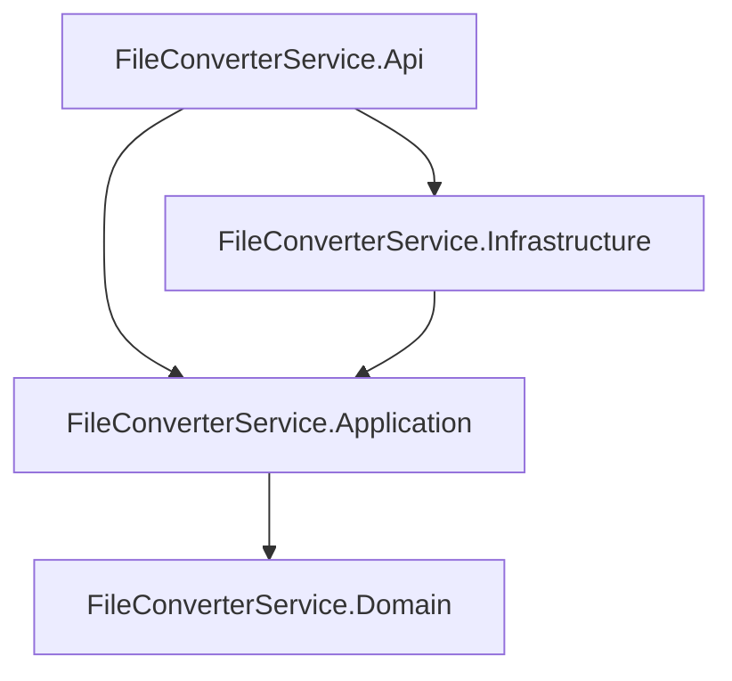
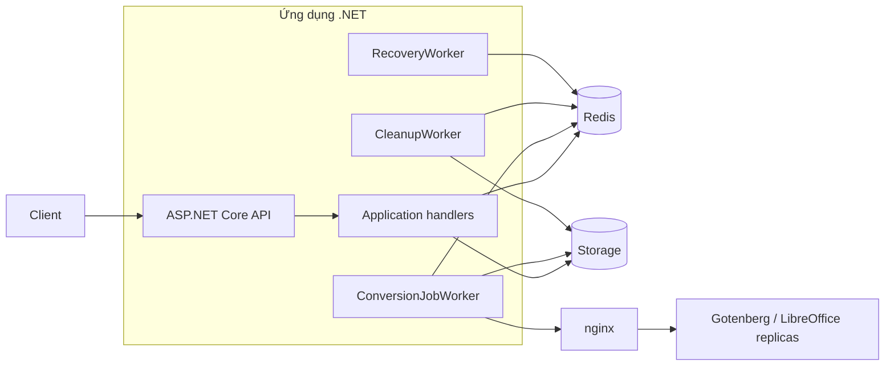
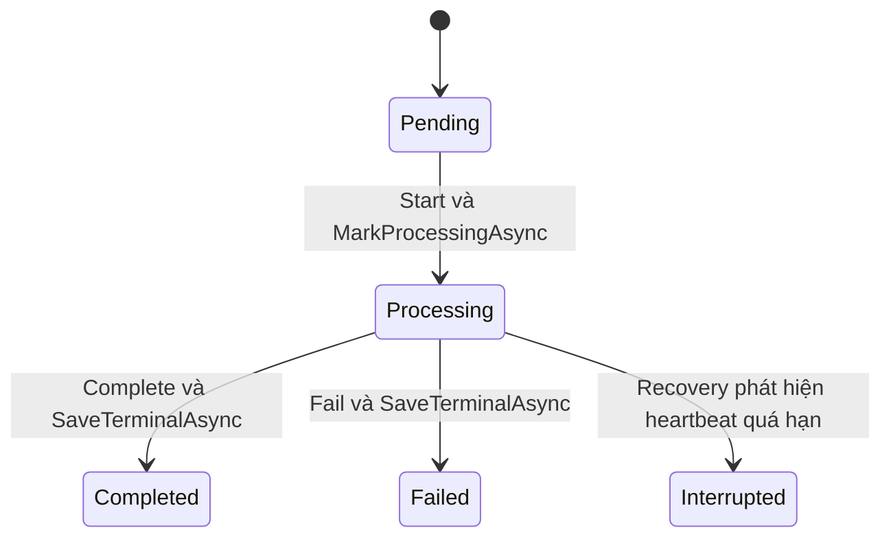
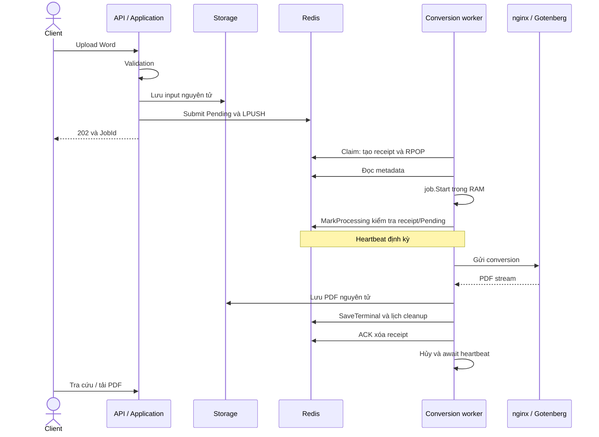
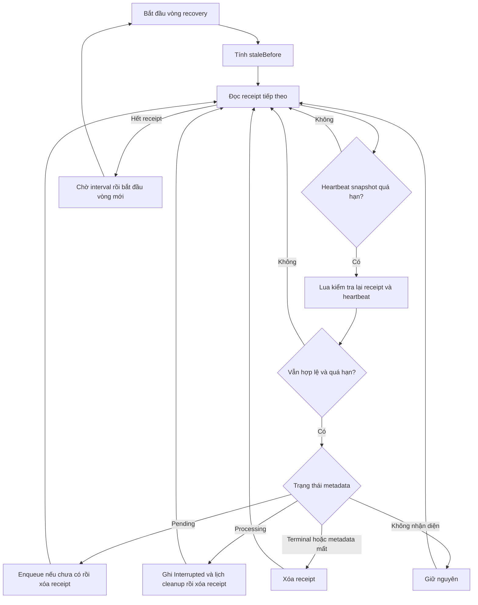

# BÁO CÁO TỔNG QUAN DỰ ÁN FILECONVERTER

Ngày cập nhật: **08/11/2026**.

Báo cáo đi theo từng project (layer), từng class và các method thuộc class; tiếp theo là ba luồng convert, cleanup, recovery và các tham số cấu hình. Nội dung mô tả hành vi đã triển khai trong mã nguồn.

## 1. Tổng quan và kiến trúc

FileConverter là gateway chuyển tài liệu Word thành PDF theo mô hình job bất đồng bộ. Client upload một hoặc nhiều file, nhận JobId cho từng file được tiếp nhận, tra cứu trạng thái và tải PDF khi job Completed. API không giữ request upload để đợi hoàn thành conversion.

Ứng dụng .NET tiếp nhận file, điều phối và quản lý vòng đời job. Gotenberg/LibreOffice thực hiện chuyển đổi thực tế. Redis lưu trạng thái và hàng đợi; filesystem lưu Word/PDF. nginx phân phối request tới các container Gotenberg.

| Khả năng | Hiện trạng |
| --- | --- |
| Upload và tạo job | Đã triển khai; nhận 1–5 file DOC/DOCX, tối đa 20 MiB/file |
| Chuyển đổi nền | Đã triển khai; ConversionJobWorker lấy job từ Redis và gọi Gotenberg |
| Tra cứu, tải PDF và DELETE | Đã triển khai bằng các use case riêng |
| Heartbeat | Đã triển khai; cập nhật LastHeartbeatAt cho từng receipt trong lúc xử lý |
| Phục hồi job Pending bị bỏ dở | Đã triển khai; RecoveryWorker đưa job lại queue và thu hồi receipt cũ |
| Dọn receipt còn sót | Đã triển khai cho Completed, Failed, Interrupted và job không còn metadata |
| Xử lý job Processing mất heartbeat | Đã triển khai; chuyển Interrupted, thu hồi receipt và lên lịch cleanup |
| Cleanup tài nguyên | Đã triển khai; Sorted Set xác định hạn dọn, xóa file trước rồi metadata/member |
| Hoãn cleanup lỗi | Đã triển khai; dời score về thời điểm retry để không giữ mãi đầu batch |
| Readiness | Đã triển khai; Redis, storage và Gotenberg; HTTP 200 hoặc 503 |

**Phạm vi recovery:** hệ thống xử lý job/receipt bị bỏ dở, nhưng không tự convert lại job Interrupted hoặc lấy lại PDF từ một HTTP response đã mất. Interrupted là kết quả ghi nhận gián đoạn của gateway, không phải kết luận conversion phía engine đã dừng.

### 1.1. Các tầng và hướng phụ thuộc

Bốn project cùng sử dụng .NET 10, bật nullable reference types và implicit usings.



Mũi tên thể hiện ProjectReference trực tiếp. Infrastructure sử dụng kiểu Domain thông qua phụ thuộc bắc cầu của Application.

| Project | Trách nhiệm | Phụ thuộc trực tiếp |
| --- | --- | --- |
| Domain | Entity, trạng thái và quy tắc chuyển trạng thái | Không phụ thuộc project khác |
| Application | Use case, DTO, validator và interface | Domain |
| Infrastructure | Redis, filesystem, HTTP converter và worker | Application |
| Api | Endpoint HTTP, middleware, cấu hình và DI | Application, Infrastructure |

Application gọi interface để không phụ thuộc Redis/HTTP/filesystem cụ thể. Api là composition root, chọn implementation. Các tính năng trong Application được chia theo use case, mỗi nhóm có input, output, validator và handler riêng.

### 1.2. Sơ đồ runtime



Ba worker chạy cùng process với API. Dừng API thì các worker trong instance đó cũng dừng. Gotenberg là tiến trình/container riêng; dừng .NET không đồng nghĩa Gotenberg đã kết thúc conversion đang chạy.

## 2. Cấu trúc thư mục

```text
FileConverter/
├── FileConverterService/
│   ├── FileConverterService.slnx
│   ├── FileConverterService.Domain/
│   │   ├── Entities/
│   │   ├── Enums/

│   ├── FileConverterService.Application/
│   │   ├── BusinessExceptions/
│   │   ├── Common/Behaviors/
│   │   ├── Constants/
│   │   ├── Converters/
│   │   ├── HelperServices/Storage/
│   │   ├── Jobs/
│   │   ├── Readiness/
│   │   ├── Repositories/
│   │   ├── UseCases/
│   │   │   ├── ConvertToPDF/
│   │   │   ├── GetJob/
│   │   │   ├── GetFileOfJob/
│   │   │   └── DeleteResourceRelatedToJob/

│   ├── FileConverterService.Infrastructure/
│   │   ├── Converters/
│   │   ├── Extensions/
│   │   ├── HelperServices/Storage/
│   │   ├── Options/
│   │   ├── Readiness/
│   │   ├── Repositories/
│   │   ├── Workers/

│   └── FileConverterService.Api/
│       ├── ApiResponseModels/
│       ├── Constants/
│       ├── Controllers/
│       ├── Middlewares/
│       ├── Properties/
│       ├── Registrations/
│       ├── Program.cs
│       ├── appsettings.json
│       ├── appsettings.Development.json
│       └── .env
├── LibreOffice/
│   ├── Gotenberg/docker-compose.yml
│   └── GotenbergCluster/
│       ├── docker-compose.yml
│       └── nginx.conf
├── Redis/docker-compose.yml
├── .agents/skills/
├── docs/
└── README.md
```

Solution `.slnx` tập hợp bốn project dịch vụ. Mỗi `.csproj` khai báo framework, package và project reference. `bin/`, `obj/` chứa dữ liệu sinh khi build. `Storage/` dưới content root của Api là thư mục runtime.

`LibreOffice/` chứa cấu hình engine và cụm proxy; `Redis/` chứa cấu hình Redis/RedisInsight. `.agents/skills/` chứa hướng dẫn phát triển, không tham gia runtime. `docs/` chứa tài liệu dự án; `README.md` là điểm giới thiệu repository.

## 3. Project Domain

### 3.1. Entities

| Class/record | File | Trách nhiệm |
| --- | --- | --- |
| ConversionJob | Entities/ConversionJob.cs | Entity một job: thông tin file, storage key, trạng thái, thời điểm và lỗi |
| ConversionJobReceipt | Entities/ConversionJobReceipt.cs | Class nhận diện một lần giao job cho worker: JobId, ReceiptId và LastHeartbeatAt |

Các thuộc tính của ConversionJob:

| Thuộc tính | Ý nghĩa |
| --- | --- |
| Id | GUID job |
| OriginalFileName | Tên file đầu vào |
| ContentType | MIME được gửi kèm file |
| InputStorageKey | Đường dẫn tương đối tới input |
| OutputStorageKey | Đường dẫn tương đối tới PDF khi hoàn tất |
| Status | ConversionJobStatus |
| CreatedAt | Thời điểm tạo UTC |
| ProccessedAt | Thời điểm bắt đầu UTC; giữ cách viết hiện có trong entity |
| CompletedAt | Thời điểm hoàn thành, thất bại hoặc ghi nhận gián đoạn |
| Error | Thông báo lỗi/gián đoạn |

| Phương thức | Hành vi |
| --- | --- |
| Constructor có tham số | Tạo GUID, CreatedAt và trạng thái Pending |
| Start() | Pending → Processing; gán ProccessedAt, xóa lỗi |
| Complete(outputStorageKey) | Processing → Completed; ghi output key và CompletedAt |
| Fail(error) | Processing → Failed; ghi Error và CompletedAt |
| Interrupt(error) | Processing → Interrupted; ghi Error và CompletedAt |
| EnsureStatus(expected) | Kiểm tra trạng thái trước khi thay đổi object |

Các phương thức trên sửa object trong RAM; không tự ghi Redis. Worker gọi atomic operation để lưu trạng thái có điều kiện. Constructor không tham số phục vụ khôi phục object từ metadata.

#### ConversionJobReceipt — vì sao cần entity này?

Khi worker lấy JobId khỏi queue, job không còn trong danh sách chờ nhưng có thể chưa được xử lý xong. Nếu process .NET crash ngay sau đó, chỉ nhìn queue sẽ không biết job đã được nhận rồi bị bỏ dở. Metadata Pending/Processing cũng không đủ để biết worker còn hoạt động hay đã dừng.

Receipt lưu dấu vết của một lần giao job. ClaimAsync tạo hash receipt và lấy job khỏi queue trong cùng Lua script, tránh khoảng hở lấy job ra nhưng chưa ghi nhận ai đang xử lý lần giao đó. 

| Thuộc tính | Công dụng |
| --- | --- |
| JobId | Liên kết receipt với metadata của job. |
| ReceiptId | Định danh riêng của lần nhận job; nếu Pending được recovery đưa lại queue, lần claim sau có ReceiptId mới. |
| LastHeartbeatAt | Snapshot thời điểm heartbeat gần nhất tại lúc tạo/đọc object; không tự đổi khi Redis được cập nhật. Recovery dùng nó để chọn receipt có khả năng quá hạn rồi kiểm tra lại trong Lua. |

| Method | Công dụng |
| --- | --- |
| ConversionJobReceipt(jobId, receiptId, lastHeartbeatAt = default) | Constructor khởi tạo ba thuộc tính chỉ đọc. Class không khai báo thêm method nghiệp vụ; thay đổi dữ liệu Redis do atomic operations thực hiện. |

Receipt phục vụ ba việc: heartbeat báo lần xử lý còn hoạt động; MarkProcessingAsync/SaveTerminalAsync/ACK kiểm tra receipt khớp JobId trước khi ghi hoặc xóa; recovery phát hiện lần giao bị bỏ dở. Sau khi lưu trạng thái kết thúc, ACK xóa receipt. Nếu worker cũ tiếp tục sau khi recovery đã xóa receipt, các thao tác ghi có kiểm tra receipt sẽ bị từ chối, tránh ghi đè kết quả của trạng thái đã được phục hồi.

Ví dụ: job A đã rời queue, còn Pending, receipt R1 tồn tại nhưng worker crash. Khi R1 mất heartbeat quá hạn, recovery đưa A lại queue và xóa R1. Worker nhận lại A sẽ có R2; worker cũ không thể dùng R1 để chuyển A sang Processing. Nếu A đã Processing khi mất heartbeat, recovery chuyển A sang Interrupted và lên lịch cleanup, không tự gửi lại conversion.

Object C# này biểu diễn dữ liệu receipt đã lưu trong Redis Hash; việc đổi từ record sang class không tạo thêm database hoặc thay đổi cấu trúc hash hiện tại.

### 3.2. Enums

`Enums/ConversionJobStatus.cs`:

| Giá trị | Tên | Ý nghĩa |
| --- | --- | --- |
| 0 | Pending | Đang chờ xử lý |
| 1 | Processing | Gateway đang theo dõi quá trình conversion |
| 2 | Completed | PDF đã lưu và trạng thái hoàn tất đã ghi |
| 3 | Failed | Gateway ghi nhận thất bại |
| 4 | Interrupted | Mất heartbeat quá hạn khi Processing, kết quả chưa rõ |



## 4. Project Application — điều phối nghiệp vụ

Application định nghĩa các use case và hợp đồng dịch vụ; không phụ thuộc Redis, filesystem hay Gotenberg cụ thể. Mỗi nhóm dưới đây nêu class, công dụng chung rồi các method do class khai báo. DTO/options chỉ mang dữ liệu được mô tả bằng thuộc tính; không liệt kê các getter/setter hay method tự sinh của record.

### 4.1. Folder UseCases/ConvertToPDF

#### ConverToPDF_UCInput

Request MediatR chứa `Files`, danh sách file cần tiếp nhận. Không khai báo method nghiệp vụ.

#### FileParams

Nằm cùng file với input, chứa `FileName`, MIME `Type` và stream `Content`. Giúp Application nhận dữ liệu file mà không phụ thuộc `IFormFile` của ASP.NET. Không khai báo method.

#### ConverToPDF_UCInputValidator

Kiểm tra điều kiện tiếp nhận trước khi handler chạy.

| Method | Công dụng |
| --- | --- |
| Constructor | Khai báo rule: 1–5 file; từng file khác null; tên không rỗng; đuôi `.doc`/`.docx` không phân biệt hoa thường; MIME tương ứng; stream khác null, đọc và seek được; dung lượng lớn hơn 0 và không quá 20 MiB/file. |

Việc thực thi các rule do FluentValidation đảm nhiệm. Giới hạn dung lượng đang hardcode; validator chưa phân tích cấu trúc nội dung Word. MIME là thông tin client gửi lên.

#### ConverToPDF_UCHandler

Tiếp nhận upload và tạo job Pending; không thực hiện conversion ngay trong request.

| Method | Công dụng |
| --- | --- |
| Constructor | Nhận dịch vụ file, atomic operations và logger qua DI. |
| Handle(input, cancellationToken) | Tạo task riêng cho mỗi file; lấy tên file an toàn, tạo input key riêng và entity; lưu input nguyên tử rồi gọi `SubmitAsync` để ghi metadata và enqueue. Chờ các task, tổng hợp JobId thành công; lỗi từng file được log để các file khác vẫn có thể được nhận. Nếu request bị hủy trước submit, cố xóa input đã lưu. Khi đã gửi thao tác submit Redis, chờ kết quả bằng token không bị hủy theo request để không bỏ chờ một thao tác có thể đã ghi. |

#### ConverToPDF_UCOutput

Mang `TotalFile`, `SuccessfulUploadedFile`, `JobIds`; không khai báo method. Kết quả phản ánh upload được tiếp nhận, không phải số PDF đã chuyển thành công.

### 4.2. Folder UseCases/GetJob

#### GetJob_UCInput

Request chứa `JobId` dạng chuỗi; không khai báo method.

#### GetJob_UCInputValidator

Constructor khai báo rule JobId parse được thành GUID và khác `Guid.Empty`; các rule chạy trước handler.

#### GetJob_UCHandler

Đọc thông tin tiến độ một job.

| Method | Công dụng |
| --- | --- |
| Constructor | Nhận repository metadata. |
| Handle(input, cancellationToken) | Parse JobId, đọc metadata; không có thì ném `NotFoundException`. Ánh xạ entity sang output, xuất trạng thái thành chuỗi; không cập nhật trạng thái và không đọc file. |

#### GetJob_UCOutput

Chứa JobId, OriginalFileName, Status, CreatedAt, ProcessedAt, CompletedAt, Error. `ProcessedAt` lấy từ thuộc tính `ProccessedAt` trong entity. Không khai báo method.

### 4.3. Folder UseCases/GetFileOfJob

#### GetFileOfJob_UCInput

Request chứa JobId; không khai báo method.

#### GetFileOfJob_UCInputValidator

Constructor khai báo rule GUID hợp lệ và khác rỗng.

#### GetFileOfJob_UCHandler

Chuẩn bị stream PDF để API trả về.

| Method | Công dụng |
| --- | --- |
| Constructor | Nhận repository và dịch vụ file. |
| Handle(input, cancellationToken) | Đọc job hoặc trả lỗi 404; yêu cầu Completed, nếu không trả lỗi 409. Kiểm tra output key, mở file và tạo tên tải xuống có đuôi PDF. File/thư mục không còn được chuyển thành lỗi nghiệp vụ 404. Trả stream cho HTTP response quản lý vòng đời. |

#### GetFileOfJob_UCOutput

Chứa stream `Content`, `FileName`, `ContentType`; không khai báo method. Tải thành công không tự xóa job/file.

### 4.4. Folder UseCases/DeleteResourceRelatedToJob

#### DeleteResourceRelatedToJob_UCInput

Request chứa JobId; không khai báo method.

#### DeleteResourceRelatedToJob_UCInputValidator

Constructor khai báo rule GUID hợp lệ và khác rỗng.

#### DeleteResourceRelatedToJob_UCHandler

Chuyển yêu cầu DELETE thủ công sang dịch vụ dọn tài nguyên dùng chung.

| Method | Công dụng |
| --- | --- |
| Constructor | Nhận `IJobCleanupService`. |
| Handle(input, cancellationToken) | Parse JobId, gọi `ExecuteAsync` ở chế độ thủ công; thành công trả JobId và Success. Các lỗi không tìm thấy hoặc trạng thái chưa cho xóa được đưa lên middleware. |

#### DeleteResourceRelatedToJob_UCOutput

Chứa JobId và Success; không khai báo method.

### 4.5. Folder Jobs

#### IJobCleanupService

Hợp đồng dọn tài nguyên một job. Method `ExecuteAsync(jobId, automatic, cancellationToken)` trả bool: true khi đã dọn job; false ở các nhánh tự động không dọn được job hoặc metadata đã mất.

#### JobCleanupService

Tập trung điều kiện xóa và thứ tự xóa để API DELETE và background cleanup dùng chung.

| Method | Công dụng |
| --- | --- |
| Constructor | Nhận repository, dịch vụ file, lịch cleanup và logger. |
| ExecuteAsync(jobId, automatic = false, cancellationToken) | Đọc metadata và kiểm tra ID khớp. Thủ công chỉ cho Completed/Failed; tự động cho thêm Interrupted. Job không còn: thủ công ném 404, tự động xóa member cleanup còn sót rồi trả false. Job chưa đủ điều kiện: thủ công ném 409, tự động trả false. Xóa input và PDF, chờ cả hai hoàn tất rồi mới xóa metadata/member bằng schedule. File đã thiếu không cản dọn; exception xóa file giữ metadata và lịch để retry. |

PDF dự phòng dùng key `output/{jobId:N}.pdf` nếu metadata chưa có OutputStorageKey. Không áp dụng lại phép trừ retention tại đây; worker đã chọn job theo score đến hạn.

### 4.6. Folder Repositories — các interface

#### IJobConversionRepository

Hợp đồng CRUD metadata, không quản lý file hay queue.

| Method | Công dụng |
| --- | --- |
| AddAsync | Lưu metadata một entity. |
| GetByIdAsync | Đọc entity theo JobId; có thể trả null. |
| UpdateAsync | Cập nhật metadata đã có. |
| DeleteAsync | Xóa metadata; không tự xóa file hoặc lịch cleanup. |

#### IConversionJobAtomicOperations

Hợp đồng thao tác có điều kiện giữa metadata, queue, receipt và lịch cleanup.

| Method | Công dụng |
| --- | --- |
| SubmitAsync | Tiếp nhận job Pending và đưa vào queue, chống submit lặp cùng JobId/metadata. |
| ClaimAsync | Lấy một job khỏi queue và tạo receipt của lần giao đó. |
| MarkProcessingAsync | Chỉ ghi Processing khi receipt hợp lệ và metadata còn Pending. |
| SaveTerminalAsync | Lưu Completed/Failed và lịch cleanup khi worker còn quyền theo receipt. |
| HeartbeatAsync | Cập nhật nhịp sống receipt; trả false nếu receipt không còn hợp lệ. |
| AcknowledgeAsync | Xác nhận xử lý xong bằng cách xóa receipt phù hợp. |
| ScanReceiptsAsync | Duyệt receipt thành luồng bất đồng bộ để recovery xem xét. |
| TryRecoverAsync | Kiểm tra lại receipt quá hạn và thực hiện nhánh recovery tương ứng. |

#### IJobCleanupSchedule

Hợp đồng truy vấn và điều chỉnh lịch cleanup.

| Method | Công dụng |
| --- | --- |
| GetDueJobIdsAsync(now, count, token) | Đọc tối đa count JobId đến hạn; chưa xóa hoặc chiếm quyền xử lý các member. |
| DeleteJobAsync | Xóa metadata và member cleanup trong cùng thao tác Redis. |
| DeferAsync | Dời lịch retry của member đang tồn tại về sau. |

### 4.7. Folder Converters và HelperServices/Storage

#### IDocumentConverter

Tách nghiệp vụ khỏi engine cụ thể. `ConvertToPdfAsync(jobId, input, fileName, callBack, token)` gửi input để chuyển đổi, cung cấp stream PDF cho callback lưu kết quả; hỗ trợ hủy tác vụ.

#### IFileManagerService

Tách use case khỏi cách lưu file cụ thể.

| Method | Công dụng |
| --- | --- |
| SaveFileAsync | Lưu stream với key chỉ định hoặc key sinh mới; trả key. |
| SaveFileAtomicallyAsync | Ghi file tạm rồi thay file đích để tránh lộ file đang ghi dở. |
| ReadFileAsync | Mở stream đọc; bên nhận chịu trách nhiệm dispose. |
| DeleteFileAsync | Xóa file; trả false nếu không có file. |
| ExistsAsync | Kiểm tra file theo storage key. |

### 4.8. Folder Readiness

#### IReadinessService

`CheckAsync(token)` kiểm tra khả năng phục vụ thực tế và trả `ReadinessResult`.

#### ReadinessResult

Record chứa dictionary `Checks` ánh xạ dependency sang bool. Thuộc tính tính toán `Ready` true khi tất cả mục đạt; không khai báo method nghiệp vụ riêng.

### 4.9. Folder Common/Behaviors

#### ValidationBehavior<TRequest,TResponse>

Pipeline MediatR chạy validation thống nhất trước use case.

| Method | Công dụng |
| --- | --- |
| Constructor | Nhận toàn bộ validator phù hợp request. |
| Handle(request, next, cancellationToken) | Chạy validator bất đồng bộ, gom lỗi theo property; có lỗi thì ném BadRequestException, hợp lệ thì gọi next để chuyển tới handler. |

### 4.10. Folder BusinessExceptions

#### BusinessException

Lớp cơ sở cho lỗi nghiệp vụ, mang Message, Code và tập Errors.

| Method/thành phần | Công dụng |
| --- | --- |
| Constructor | Nhận thông báo và tập lỗi ban đầu nếu có. |
| AddError | Thêm lỗi theo tên trường; bổ sung vào nhóm đã có hoặc tạo nhóm mới. |
| Errors getter | Trả bản sao dictionary lỗi, hạn chế việc bên ngoài sửa trực tiếp dữ liệu nội bộ. |

Mỗi class con sau chỉ khai báo constructor truyền message/errors vào base và Code tương ứng; không có method xử lý nghiệp vụ khác:

| Class | Công dụng |
| --- | --- |
| BadRequestException | Input hoặc yêu cầu không hợp lệ, mã 400. |
| UnauthorizedException | Chưa xác thực, mã 401. |
| ForbiddenException | Không đủ quyền, mã 403. |
| NotFoundException | Không có tài nguyên, mã 404. |
| ConflictUniqueValueException | Xung đột nghiệp vụ, mã 409; file tên ConflictUniqueValue.cs. |

### 4.11. Folder Constants

| Class | Công dụng và method |
| --- | --- |
| BussinessRuleMessage | Tập thông báo validation, chia nhóm lồng FileValidator và JobValidator; không có method. |
| ApplicationErrorMessage | Tập thông báo lỗi job/file dùng chung; không có method. |

## 5. Project Infrastructure — triển khai dịch vụ kỹ thuật

Infrastructure hiện thực các interface của Application bằng Redis, filesystem và HTTP Gotenberg; đồng thời chứa ba background worker.

### 5.1. Folder Repositories

#### RedisJobConversionRepository

Lưu/đọc ConversionJob bằng Redis Hash; dùng RedisHashExtensions để ánh xạ object.

| Method | Công dụng |
| --- | --- |
| Constructor | Lấy IDatabase từ connection và đọc các prefix trong RedisOptions. |
| AddAsync | Ghi thuộc tính entity vào hash; không enqueue. |
| GetByIdAsync | Tạo key từ prefix/JobId, đọc hash và deserialize; hash rỗng trả null. |
| UpdateAsync | Kiểm tra key còn tồn tại rồi ghi lại thuộc tính; thiếu key ném lỗi. Hai bước này không phải một điều kiện ghi nguyên tử. |
| DeleteAsync | Xóa Redis key metadata, không dọn file hay Sorted Set. |

#### RedisConversionJobAtomicOperations

Thực hiện các thay đổi liên quan bằng Lua để lệnh từ client khác không chen vào giữa bước kiểm tra và bước ghi trên cùng Redis server.

| Method | Công dụng và điều kiện |
| --- | --- |
| Constructor | Nhận connection/options; chuẩn bị database, key/prefix, polling và retention. |
| SubmitAsync | Yêu cầu job Pending có ID. Tính SHA-256 trên bộ metadata định danh của lần submit; chuyển entity thành các cặp field/value. Lua kiểm tra kiểu dữ liệu, fingerprint rồi ghi hash và LPUSH. Cùng JobId/fingerprint đã có thì không enqueue thêm; khác fingerprint bị từ chối. Nếu LPUSH báo lỗi sau khi tạo hash mới, script cố xóa hash vừa tạo. |
| ClaimAsync | Lặp cho tới có job hoặc bị hủy. Lua đọc cuối queue, tạo hash receipt gồm JobId/LastHeartbeatAt rồi RPOP trong cùng script; trả ConversionJobReceipt. Queue rỗng thì Task.Delay theo polling. |
| GetReceiptKey | Method private tạo key từ prefix và ReceiptId dạng N, kiểm tra không trùng các key dùng chung. |
| MarkProcessingAsync | Kiểm tra object đã Start và claim khớp job. Lua xác nhận receipt thuộc job, metadata vẫn Pending rồi ghi Status=1, ProccessedAt và xóa Error. Không dùng UpdateAsync chung để tránh ghi bằng receipt đã bị thu hồi. |
| SaveTerminalAsync | Chỉ nhận Completed/Failed có CompletedAt. Lua kiểm tra receipt thuộc job; metadata còn Processing hoặc đúng trạng thái kết thúc tương thích. Ghi hash và ZADD lịch cleanup trong cùng script. Score bằng CompletedAt cộng retention thường. Lưu lại cùng trạng thái yêu cầu CompletedAt khớp; không tự ACK. |
| HeartbeatAsync | Lua đọc JobId trong receipt, khớp mới HSET LastHeartbeatAt bằng Unix milliseconds hiện tại. Receipt mất/không khớp trả false và không tạo lại. Method này không kiểm tra hash metadata job. |
| AcknowledgeAsync | Lua chỉ DEL receipt nếu JobId trong receipt khớp claim. Gọi lặp khi receipt đã mất không tạo dữ liệu mới. |
| ScanReceiptsAsync | Duyệt các primary qua GetServer, SCAN key theo prefix và page size; HMGET JobId/LastHeartbeatAt từng receipt. Parse GUID/timestamp hợp lệ rồi yield claim; không sửa dữ liệu. |
| TryRecoverAsync | Lua đọc lại receipt, JobId và heartbeat <= staleBefore. Metadata mất thì bỏ receipt; Pending thì LPUSH nếu chưa ở queue rồi bỏ receipt; Completed/Failed/Interrupted thì bỏ receipt; Processing thì ghi Interrupted/Error/CompletedAt, ZADD lịch riêng rồi bỏ receipt. Trả true khi thực hiện nhánh recovery, false khi điều kiện không còn đúng. |

Fingerprint là mã băm của metadata, không phải mã băm nội dung file. Submit file giống nhau bằng JobId mới vẫn tạo job mới.

Các script là chuỗi hằng nội bộ tương ứng từng thao tác. Redis chạy từng script lần lượt; script không chứa việc convert hoặc đọc/ghi file. Tính nguyên tử ở đây không có nghĩa Redis tự rollback mọi lệnh đã chạy nếu script gặp lỗi runtime.

#### RedisJobCleanupSchedule

Quản lý Sorted Set cleanup: member là JobId, score là thời điểm được phép dọn hoặc mốc retry.

| Method | Công dụng |
| --- | --- |
| Constructor | Lấy database, prefix metadata và cleanup key. |
| GetDueJobIdsAsync | Truy vấn score từ -inf đến now, tăng dần, offset 0 và tối đa count; parse member thành GUID. Đây là thao tác đọc, member còn đó cho tới khi xóa thành công. |
| DeleteJobAsync | Lua xác thực trạng thái metadata nếu còn, cho phép Completed/Failed/Interrupted; ZREM member và DEL metadata trong cùng script. Không xóa file. |
| DeferAsync | Lua ZADD XX GT: chỉ tăng thời điểm của member đang tồn tại. Không tạo lại lịch nếu tác vụ khác đã xóa member. |

### 5.2. Folder Workers

#### ConversionJobWorker

Worker nhận job và điều khiển toàn bộ một lần conversion. Nhiều async loop cho phép các job độc lập chạy song song.

| Method | Công dụng |
| --- | --- |
| Constructor | Nhận atomic operations, repository, file manager, converter, options, logger; kiểm tra concurrency và heartbeat interval. |
| ExecuteAsync | Khởi chạy MaxConcurrentJobs vòng ProcessJobsAsync và chờ bằng Task.WhenAll; xử lý hủy khi host dừng. |
| ReadJobs | Async iterator gọi ClaimAsync để cung cấp claim; lỗi nhận job được log và chờ trước khi thử lại; host dừng thì kết thúc. |
| ProcessJobsAsync | Với từng claim: tạo token xử lý và heartbeat riêng, đọc metadata, xác minh ID/trạng thái. Pending thì job.Start và MarkProcessingAsync; mở input, gọi converter với callback lưu PDF nguyên tử; Complete hoặc Fail; SaveTerminalAsync rồi ACK. Lỗi lưu Redis giữ receipt cho recovery. Finally hủy và await heartbeat trước khi chuyển claim tiếp theo. |
| RunHeartbeatAsync | Chờ Task.Delay theo interval rồi gửi heartbeat. Receipt invalid thì hủy token xử lý claim; lỗi Redis được log và thử lại nhịp sau. Dừng khi token heartbeat bị hủy. |

`job.Start()` sửa object trong RAM; MarkProcessingAsync kiểm tra và ghi Redis. Token heartbeat riêng cho phép dừng nhịp sống khi job xong mà không phải hủy công việc đã hoàn tất. Các token đều liên kết với token dừng host.

#### CleanupWorker

Dọn tài nguyên đã đến hạn theo từng batch; lỗi một job không ngăn xử lý các job còn lại trong batch.

| Method | Công dụng |
| --- | --- |
| Constructor | Nhận schedule, cleanup service, options, TimeProvider và logger. |
| ExecuteAsync | Lấy tối đa BatchSize member có score <= now; gọi cleanup tự động từng job. Nếu trả false hoặc ném lỗi thì gọi DeferRetryAsync, tiếp tục job khác. Sau batch chờ IntervalSeconds; không có vòng lặp vét hết backlog. |
| DeferRetryAsync | Dời lịch tới thời điểm hiện tại cộng hai interval. Nếu Redis không cho hoãn được thì log và giữ dữ liệu để vòng sau thử tiếp. |

#### RecoveryWorker

Phát hiện receipt mất heartbeat và xử lý job bị bỏ dở theo trạng thái hiện có.

| Method | Công dụng |
| --- | --- |
| Constructor | Nhận atomic operations, RecoveryOptions, TimeProvider và logger. |
| ExecuteAsync | Tính staleBefore = now - HeartbeatTimeoutSeconds; duyệt toàn bộ receipt theo trang, bỏ qua heartbeat còn mới. Với receipt quá hạn, gọi TryRecoverAsync để kiểm tra lại và thay đổi nguyên tử. Lỗi từng receipt được log riêng; sau vòng quét chờ IntervalSeconds. |

### 5.3. Folder Converters

#### GotenbergDocumentConverter

Adapter HTTP chuyển input sang PDF thông qua Gotenberg.

| Method | Công dụng |
| --- | --- |
| Constructor | Nhận HttpClient, GotenbergOptions và logger. |
| ConvertToPdfAsync | Kiểm tra tham số, tạo deadline liên kết token caller, gọi SendWithRetryAsync; yêu cầu HTTP thành công; đọc PDF dưới dạng stream và gọi callback lưu. Deadline bao gồm gửi, chờ retry, đọc PDF và callback; quá deadline được diễn giải thành TimeoutException khi caller chưa hủy. |
| SendWithRetryAsync | Tạo multipart POST `/forms/libreoffice/convert`, dùng ResponseHeadersRead. Stream seek được sẽ reset về vị trí ban đầu cho mỗi attempt; stream không seek chỉ gửi một lần. Retry một số lỗi mạng/timeout/HTTP 5xx khi còn lượt, dispose response lỗi rồi delay; lỗi đọc PDF hoặc callback nằm ngoài vòng gửi lại này. |

#### LeaveOpenReadStream — class private lồng trong converter

Bọc input stream để việc dispose multipart không đóng input gốc cần dùng cho attempt sau.

| Method/thành phần | Công dụng |
| --- | --- |
| Constructor | Nhận stream gốc và từ chối null. |
| Read, ReadAsync | Chuyển các overload đọc đồng bộ/bất đồng bộ sang stream gốc. |
| Seek | Chuyển thao tác đổi vị trí sang stream gốc. |
| Flush, SetLength, Write | Ném NotSupportedException vì wrapper chỉ phục vụ đọc. |
| CanRead, CanSeek, Length, Position | Phản ánh stream gốc; CanWrite=false. Dispose wrapper không đóng stream gốc. |

#### GotenbergOptions

Chứa BaseUrl, TimeoutInMinutes, DeadlineInMinutes, MaxAttempts, RetryDelayInMinutes; không khai báo method. Chi tiết cấu hình ở phần 9.

### 5.4. Folder HelperServices/Storage

#### LocalFileManagerService

Lưu file dưới một root cố định, dùng storage key tương đối và hỗ trợ ghi file nguyên tử ở bước công bố kết quả.

| Method | Công dụng |
| --- | --- |
| Constructor | Kiểm tra RootPath, chuẩn hóa đường dẫn và tạo root. |
| ResolvePath | Method private kết hợp key với root, GetFullPath rồi kiểm tra đường dẫn còn dưới root; từ chối đường dẫn thoát root. |
| SaveFileAsync | Tạo thư mục cha, mở file ghi bất đồng bộ, copy stream; trả storage key. Ghi trực tiếp nên có thể để lại file dở nếu bị lỗi. |
| SaveFileAtomicallyAsync | Ghi sang temp cùng thư mục, đóng handle, kiểm tra hủy rồi File.Move đè file đích; finally dọn temp còn sót. Người đọc không thấy nội dung file đích đang ghi dở qua bước ghi này. |
| ReadFileAsync | Mở FileStream đọc bất đồng bộ; caller dispose stream. |
| DeleteFileAsync | Resolve key, kiểm tra tồn tại và xóa; file thiếu trả false, lỗi filesystem được ném lên. |
| ExistsAsync | Resolve key và trả kết quả File.Exists. |

#### StorageOptions

Chứa RootPath; không khai báo method. Api thiết lập root theo content root của ứng dụng.

### 5.5. Folder Extensions

#### RedisHashExtensions

Static partial class nằm trong hai file HashSetWithObject và HashGetToObject; ánh xạ public property sang field Redis Hash, value serialize bằng JSON.

| Method | Công dụng |
| --- | --- |
| ToHashEntries | Reflection các public property đọc được, bỏ indexer, tạo HashEntry tên property/value JSON. |
| HashSetObjectAsync | Chuyển object thành HashEntry rồi gọi HashSetAsync; hỗ trợ hủy việc chờ. |
| HashGetToObjectAsync<T> | HGETALL; hash rỗng trả null, nếu có thì gọi FromHashEntries. |
| FromHashEntries<T> | Method private tạo object, tìm property/setter kể cả private setter rồi deserialize theo kiểu property; bỏ field không ánh xạ như _SubmissionFingerprint. |

### 5.6. Folder Readiness

#### ReadinessService

Đánh giá Redis, storage và HTTP Gotenberg có sẵn sàng phục vụ hay không.

| Method | Công dụng |
| --- | --- |
| Constructor | Nhận connection, file manager, HttpClient, options và logger. |
| CheckAsync | Tạo deadline chung; chạy đồng thời Redis PING, kiểm tra storage và GET `/health`; gom bool từng dependency vào ReadinessResult. |
| ProbeAsync | Method private bọc từng phép kiểm tra; log lỗi và trả false khi dependency lỗi/deadline hết. Nếu caller hủy request thì cho cancellation truyền lên. |
| CheckStorageAsync | Ghi file probe vào input và output, đọc lại byte để xác nhận, finally xóa probe bằng token độc lập để cố dọn khi request đã bị hủy. |

### 5.7. Folder Options

Các class dưới đây mang cấu hình, không khai báo method nghiệp vụ. Rule kiểm tra giá trị được đặt ở Api/Registrations.

| Class | Công dụng/thuộc tính chính |
| --- | --- |
| RedisOptions | ConnectionString, QueueKey, ReceiptKey, JobKey, BatchKey, CleanupKey, PollIntervalMilliseconds. |
| ConversionWorkerOptions | MaxConcurrentJobs mỗi instance và HeartbeatIntervalSeconds. |
| CleanupOptions | RetentionMinutes, InterruptedRetentionMinutes, IntervalSeconds, BatchSize. |
| RecoveryOptions | HeartbeatTimeoutSeconds, IntervalSeconds, ScanPageSize. |
| ReadinessOptions | TimeoutSeconds cho readiness. |

## 6. Project Api — HTTP và khởi tạo ứng dụng

### 6.1. Folder Controllers

#### ConversionsController

Nhận HTTP, chuyển dữ liệu sang use case qua MediatR và định dạng response.

| Method | Route và công dụng |
| --- | --- |
| Constructor | Nhận ISender. |
| ConvertToPDF | POST `/api/conversions`: mở stream upload, tạo FileParams, gửi ConverToPDF_UCInput; trả 202 cùng kết quả tiếp nhận. Finally dispose các input stream đã mở. |
| GetJob | GET `/api/conversions/job/{jobId}`: gửi GetJob_UCInput, bọc output trong ApiSuccessResponse và trả 200. |
| GetFileOfJob | GET `/api/conversions/job/{jobId}/file`: gửi use case, trả File response chứa PDF stream/MIME/tên tải về; không bọc JSON. |
| DeleteResourceRelatedToJob | DELETE `/api/conversions/job/{jobId}`: gửi use case xóa thủ công, trả JSON kết quả 200. |

#### CheckController

Cung cấp liveness của process và readiness phụ thuộc.

| Method | Công dụng |
| --- | --- |
| Constructor | Nhận IReadinessService. |
| CheckHealth | GET `/check/health`, trả 200 với thông tin healthy; không gọi dependency. |
| CheckReady | GET `/check/ready`, gọi CheckAsync; trả 200 nếu Ready=true, ngược lại 503 và danh sách dependency lỗi. |

### 6.2. Folder ApiResponseModels

| Class | Công dụng và method |
| --- | --- |
| ApiResponse<T> | Abstract chứa Success, Message, Data; không có method nghiệp vụ. |
| ApiSuccessResponse<T> | Constructor nhận data/message; Success=true. |
| ApiErrorResponse | Constructor nhận message/dictionary lỗi; Success=false, Data chứa lỗi theo trường hoặc dependency. |

### 6.3. Folder Middlewares

#### GlobalExceptionHandlerMiddleware

Chuyển exception từ pipeline thành response lỗi thống nhất.

| Method | Công dụng |
| --- | --- |
| Constructor | Nhận logger. |
| InvokeAsync | Gọi middleware tiếp theo, bắt/log lỗi; RequestAborted được xử lý riêng và gán 499 nếu response chưa bắt đầu. Lỗi khác chuyển sang HandleExceptionAsync. |
| HandleExceptionAsync | Method private ánh xạ business exception sang 400/401/403/404/409, lỗi khác thành 500; serialize ApiErrorResponse với JSON camelCase. |

### 6.4. Folder Registrations

Mỗi class là static extension class chuyên đăng ký một nhóm dependency. Các method trả IServiceCollection để gọi nối tiếp khi khởi tạo host.

| Class | Method | Công dụng |
| --- | --- | --- |
| ConfigurationOptionsRegistration | RegisterConfigurationOptions | Bind section Redis/Worker/Cleanup/Recovery/Readiness/Gotenberg; kiểm tra giá trị và ValidateOnStart; thiết lập StorageOptions.RootPath. |
| HelperServicesRegistration | RegisterHelperServices | Đăng ký connection Redis và các singleton storage, atomic operations, cleanup service, schedule, TimeProvider.System; typed HttpClient cho converter/readiness. |
| RepositoryRegistration | RegisterRepositories | Đăng ký IJobConversionRepository thành RedisJobConversionRepository, vòng đời singleton. |
| UseCasesHandlersRegistration | RegisterUseCasesHandlers | Lấy assembly qua ConverToPDF_UCInput, đăng ký MediatR handler, ValidationBehavior và quét validator trong Application. |
| WorkersRegistration | RegisterWorkers | AddHostedService cho ConversionJobWorker, CleanupWorker và RecoveryWorker; ba worker chạy cùng host .NET. |
| MiddlewareRegistration | RegisterMiddlewares | Đăng ký GlobalExceptionHandlerMiddleware. |

### 6.5. Program, Constants và file cấu hình

#### Program

`Main` là điểm vào ứng dụng: nạp `.env` bằng Env.NoClobber, tạo builder, đăng ký controllers/OpenAPI và các dependency; build host; thiết lập exception middleware, OpenAPI khi Development, HTTPS redirection, authorization, controllers rồi chạy host.

#### ApiErrorResponseMessage

Class trong Constants chứa thông báo lỗi mặc định của Api; không có method.

`Properties/launchSettings.json` chứa profile chạy local và cổng HTTP/HTTPS. `appsettings.json` và `appsettings.Development.json` chứa logging/host settings; `.env` chứa cấu hình kết nối và worker. UseAuthorization hiện có trong pipeline nhưng không đồng nghĩa đã triển khai authentication/chính sách bảo vệ endpoint.


## 7. Các luồng hoạt động

Ba worker đều được đăng ký bằng AddHostedService và chạy cùng process .NET của Api. Chúng chạy độc lập, không gọi nhau theo một chuỗi cố định. Redis là nơi lưu dữ liệu để chúng phối hợp:

| Worker | Đầu vào | Trách nhiệm | Khi nào chờ? |
| --- | --- | --- | --- |
| ConversionJobWorker | Pending queue | Nhận job, duy trì heartbeat, convert và lưu kết quả | Queue rỗng thì chờ polling; lỗi claim thì chờ 3 giây. Có job thì xử lý tiếp ngay. |
| CleanupWorker | Sorted Set cleanup | Xóa tài nguyên các job đã đến hạn | Chờ IntervalSeconds sau mỗi batch, kể cả khi còn backlog. |
| RecoveryWorker | Các hash receipt | Xử lý lần giao job bị bỏ dở do heartbeat quá hạn | Chờ IntervalSeconds sau mỗi vòng quét receipt. |

Conversion worker ghi lịch cleanup sau Completed/Failed; recovery ghi lịch cleanup sau Interrupted. Cleanup worker chỉ đọc các lịch này để dọn khi tới hạn. Host dừng sẽ phát cancellation cho cả ba; nếu process crash, receipt đã lưu trong Redis là dấu vết để recovery xử lý sau khi dịch vụ hoạt động trở lại.

### 7.1. Luồng use case convert: tiếp nhận và chuyển đổi nền



Giữa claim và MarkProcessing, metadata có thể vẫn Pending dù job đã ra queue và có receipt. Recovery xử lý trường hợp worker dừng tại khoảng này.

#### ConversionJobWorker: từng bước của một lần xử lý

API đã lưu input, metadata Pending và enqueue trước khi worker nhận job. Việc trả 202 cho client không phải tín hiệu conversion đã xong.

1. **Khởi tạo các vòng xử lý:** ExecuteAsync tạo MaxConcurrentJobs vòng ProcessJobsAsync. Mỗi vòng xử lý lần lượt từng job; các vòng chạy đồng thời. Vòng chỉ claim tiếp khi đã kết thúc xử lý claim hiện tại, không lấy sẵn cả batch để chờ trong RAM.
2. **Nhận job:** ReadJobs gọi ClaimAsync. Lua tạo receipt và lấy JobId khỏi queue nguyên tử. Nếu queue rỗng, ClaimAsync chờ PollIntervalMilliseconds rồi thử lại. Nếu claim ném lỗi, ReadJobs log và chờ 3 giây.
3. **Bắt đầu theo dõi lần giao:** tạo hai CancellationTokenSource riêng cho xử lý và heartbeat, đều liên kết với token host. Khởi chạy RunHeartbeatAsync song song ngay trước khi đọc metadata.
4. **Đọc và kiểm tra metadata:** yêu cầu ID trong metadata khớp JobId của receipt. Chỉ Pending được đưa vào conversion; các nhánh khác được mô tả ở bảng bên dưới.
5. **Chuyển Processing:** gọi job.Start() để sửa object trong RAM; MarkProcessingAsync kiểm tra receipt còn hợp lệ và trạng thái Redis còn Pending, rồi mới ghi Processing cùng thời điểm bắt đầu.
6. **Chuyển đổi và lưu file:** mở input, gửi stream tới Gotenberg. Khi nhận PDF, callback lưu nguyên tử vào output/{jobId:N}.pdf. Sau khi converter và callback hoàn tất, kiểm tra cancellation rồi gọi job.Complete(outputKey).
7. **Ghi nhận thất bại nếu có:** exception trong bước đọc input/convert/lưu PDF, khi token xử lý chưa bị hủy, được log và gọi job.Fail(error). Nếu token đã bị hủy thì không chuyển sang Failed theo nhánh này.
8. **Lưu kết quả vào Redis:** kiểm tra token rồi gọi SaveTerminalAsync để ghi Completed/Failed cùng lịch cleanup. Receipt phải còn khớp job. PDF đã lưu chưa đủ để xem là Completed nếu bước ghi Redis này thất bại.
9. **ACK:** chỉ sau khi lưu terminal thành công mới gọi AcknowledgeAsync để xóa receipt. Metadata, file và lịch cleanup vẫn được giữ.
10. **Kết thúc lần xử lý:** finally gọi heartbeat.Cancel() và await heartbeatTask để nhịp sống dừng hẳn, rồi vòng xử lý mới nhận job tiếp theo.

| Tình huống | Worker làm gì? | Dữ liệu còn lại cho recovery |
| --- | --- | --- |
| Metadata không còn | Log, bỏ qua conversion | Giữ receipt; recovery sẽ bỏ receipt mồ côi khi quá hạn. |
| ID metadata không khớp | Ném lỗi, log | Không ACK; receipt được giữ để điều tra/xử lý sau. |
| Job đã Completed/Failed/Interrupted | ACK receipt hiện tại rồi bỏ qua | Không convert lại, không đổi metadata. |
| Job đã Processing khi đọc | Bỏ qua, không gửi conversion mới | Giữ receipt để recovery xem xét khi heartbeat hết hạn. |
| MarkProcessing hoặc SaveTerminal lỗi | Log, không chủ động ACK | Receipt còn trong Redis nếu thao tác trước chưa xóa nó. Recovery kiểm tra trạng thái thực tế, không chỉ dựa vào lỗi phía client. |
| SaveTerminal thành công nhưng ACK lỗi | Log; kết thúc heartbeat | Recovery thấy trạng thái terminal và xóa receipt còn sót. |
| Heartbeat xác nhận receipt invalid | Hủy token xử lý claim | Các thao tác I/O hỗ trợ cancellation sẽ dừng; kiểm tra receipt trong Lua chặn lần xử lý cũ ghi trạng thái. |
| Host dừng/crash giữa conversion | Không có bảo đảm lưu được trạng thái kết thúc ngay | Receipt còn lưu giúp recovery phát hiện Processing bị gián đoạn. |

### 7.2. Heartbeat và quyền ghi trạng thái

Mỗi lần claim tạo một ReceiptId mới và hash receipt riêng. Worker duy trì vòng heartbeat trong lúc đọc input, chuyển đổi, lưu kết quả và ACK:

```text
Claim thành công, có LastHeartbeatAt ban đầu
→ Bắt đầu vòng Task.Delay theo HeartbeatIntervalSeconds
→ HeartbeatAsync kiểm tra JobId trong receipt và cập nhật timestamp
→ Job kết thúc: hủy vòng heartbeat và await nó trong finally
```

Nếu receipt mất hoặc không khớp job, HeartbeatAsync trả false và worker hủy token xử lý claim đó. Lỗi kết nối Redis không bị coi là thu hồi receipt; worker log và thử heartbeat lại.

Heartbeat chờ một interval trước lần gửi đầu tiên; receipt đã có LastHeartbeatAt ban đầu từ ClaimAsync. Mỗi nhịp tiếp theo chờ Task.Delay rồi gọi Redis, nên khoảng cách thực tế còn gồm thời gian gọi Redis. Khi job hoàn tất, nhánh finally dừng heartbeat; không tiếp tục gửi cho job đó trong lúc chờ cleanup. Cancel là yêu cầu hủy có phối hợp, không phải lệnh cưỡng bức dừng engine Gotenberg từ xa.

Heartbeat không thay thế kiểm tra lúc ghi. MarkProcessingAsync kiểm tra receipt và trạng thái Redis còn Pending trước khi ghi Processing. SaveTerminalAsync kiểm tra receipt và trạng thái trước khi lưu Completed/Failed cùng lịch cleanup. Các kiểm tra và thay đổi nằm trong cùng Lua script; receipt đã bị recovery xóa không cho phép worker cũ ghi trạng thái tiếp.

### 7.3. Luồng cleanup

#### CleanupWorker: từng bước của một vòng

1. **Bắt đầu vòng:** lấy now từ TimeProvider. Vòng đầu chạy ngay khi worker được host khởi động, không đợi interval trước.
2. **Chọn một batch:** GetDueJobIdsAsync lấy tối đa BatchSize member có score <= now, theo score tăng dần. Member được đọc vẫn nằm trong Sorted Set; đọc lịch chưa đồng nghĩa đã xóa job.
3. **Dọn từng job:** duyệt tuần tự các JobId trong batch và gọi JobCleanupService.ExecuteAsync(automatic: true). Mỗi job có try/catch riêng, nên lỗi một job không bỏ qua các job còn lại.
4. **Xác thực trước khi xóa:** service đọc metadata, kiểm tra ID và trạng thái. Chấp nhận Completed/Failed/Interrupted ở chế độ tự động; Pending/Processing không bị dọn bởi nhánh này.
5. **Xóa file trước:** service gọi xóa output và input rồi chờ Task.WhenAll. File không tồn tại được xem là đã không còn tài nguyên cần dọn, không phải lỗi chặn xóa metadata. Nếu một thao tác ném exception, chưa gọi xóa Redis.
6. **Xóa Redis sau:** khi các thao tác file hoàn tất, DeleteJobAsync dùng Lua xóa member cleanup và metadata. Receipt không thuộc thao tác cleanup này.
7. **Hoãn khi lỗi/bỏ qua:** nếu service trả false hoặc ném exception, DeferRetryAsync dời member hiện có tới thời điểm hiện tại + 2 × IntervalSeconds. ZADD XX GT không tạo lại member đã bị xóa và không kéo lịch về sớm hơn.
8. **Sang vòng sau:** sau khi duyệt hết batch, Task.Delay theo IntervalSeconds rồi lấy batch mới. Nếu truy vấn schedule lỗi thì log và vẫn chờ interval trước lần thử tiếp.

| Tình huống | Kết quả |
| --- | --- |
| Job chỉ còn metadata, file đã mất | Vẫn xóa metadata và member cleanup khi trạng thái cho phép. |
| Member tồn tại nhưng metadata mất | Service xóa member mồ côi, trả false; lời gọi hoãn sau đó không tạo lại member. |
| Job còn Pending/Processing | Không xóa file/metadata; trả false và hoãn member. |
| Xóa một file thành công, file kia lỗi | Giữ metadata/lịch; lần sau thử lại. File đã xóa không gây lỗi vì thiếu file được chấp nhận. |
| Xóa file xong nhưng Redis lỗi | File có thể đã mất, metadata/member có thể còn; vòng sau đọc lại và dọn tiếp. |
| Hoãn lịch cũng lỗi | Log, tiếp tục job khác; member còn hạn cũ có thể được lấy lại ở vòng sau. |

Ví dụ có 200 job đến hạn, BatchSize=100: vòng đầu xử lý tối đa 100; chờ interval rồi vòng sau lấy phần còn lại cùng các job mới tới hạn. Job lỗi được dời về sau để nhường batch kế tiếp cho các member đến hạn khác nếu thao tác hoãn thành công.

```text
Lấy tối đa BatchSize job có score <= now
→ Đọc metadata và xác thực trạng thái
→ Xóa input/PDF
→ Lua xóa metadata và member cleanup
→ Chờ IntervalSeconds
```

Completed/Failed và Interrupted dùng chung Sorted Set và chung thao tác dọn input, PDF, metadata. Khác biệt nằm ở hạn ghi vào score:

| Trạng thái | Thời điểm đến hạn |
| --- | --- |
| Completed/Failed | CompletedAt + CLEANUP__RetentionMinutes |
| Interrupted | Thời điểm recovery ghi nhận gián đoạn + CLEANUP__InterruptedRetentionMinutes |

Score được lưu khi job kết thúc/gián đoạn. Cleanup lấy score <= now, không tính lại cutoff từ CompletedAt. Mỗi vòng lấy một batch, không lặp liên tục tới khi hết backlog.

Lỗi hoặc bỏ qua: hoãn member tới now + 2 × IntervalSeconds. Metadata đã mất: bỏ member còn sót. Hoãn không tạo lại member đã xóa.

### 7.4. Luồng recovery

#### RecoveryWorker: từng bước của một vòng

1. **Xác định ngưỡng quá hạn:** tính staleBefore = now - HeartbeatTimeoutSeconds một lần ở đầu vòng. Heartbeat <= ngưỡng là ứng viên recovery; heartbeat mới hơn ngưỡng được bỏ qua trong vòng này.
2. **Duyệt receipt:** ScanReceiptsAsync quét key receipt theo trang trên các Redis primary, đọc JobId và LastHeartbeatAt. ScanPageSize là kích thước trang gợi ý, không phải số receipt tối đa của cả vòng.
3. **Lọc ứng viên:** worker so LastHeartbeatAt snapshot với staleBefore. Ví dụ now=10:05:00, timeout=60 giây thì ngưỡng là 10:04:00; heartbeat 10:03:50 được xét, heartbeat 10:04:30 được bỏ qua.
4. **Kiểm tra lại nguyên tử:** gọi TryRecoverAsync. Lua đọc lại receipt/JobId/heartbeat trong Redis. Nếu worker vừa heartbeat sau lúc SCAN đọc, script thấy heartbeat mới hơn ngưỡng và không recovery receipt đó.
5. **Rẽ nhánh theo metadata:** Pending được đưa lại queue nếu chưa có; Processing chuyển Interrupted và được lên lịch cleanup; trạng thái terminal hoặc metadata đã mất thì chỉ dọn receipt. Bảng bên dưới mô tả đầy đủ từng nhánh.
6. **Cô lập lỗi từng receipt:** lỗi TryRecoverAsync được log, worker tiếp tục receipt khác. Nếu lỗi cả quá trình quét thì kết thúc lượt quét đó, log và thử lại ở vòng sau.
7. **Chờ vòng sau:** sau khi quét xong, chờ RECOVERY__IntervalSeconds. Vòng đầu bắt đầu ngay khi worker khởi động. Receipt vừa trở nên quá hạn trong lúc quét có thể được xét ở vòng tiếp theo.



Recovery không mở input, không gọi Gotenberg và không dò PDF để kết luận thành công. Nó dựa trên receipt quá hạn và metadata đang có. Vì vậy Processing sau crash được chuyển Interrupted dù engine có thể đã nhận file; không tự chạy lại một conversion chưa rõ kết quả.

RecoveryWorker được đăng ký AddHostedService và chạy cùng host. Nó quét receipt theo từng trang, lọc heartbeat quá hạn rồi gọi TryRecoverAsync. Lua đọc lại heartbeat và metadata tại thời điểm thực thi, không chỉ tin snapshot từ SCAN.

```text
Khởi động host
→ Quét các hash receipt theo prefix
→ Tính staleBefore = now - HeartbeatTimeoutSeconds
→ Với receipt có heartbeat <= staleBefore:
   → Lua kiểm tra lại receipt, JobId, heartbeat và trạng thái
   → Thực hiện một trong các nhánh bên dưới
→ Quét hết các trang
→ Chờ IntervalSeconds rồi lặp lại
```

| Case hiện tại trong Redis | Thao tác của recovery | Kết quả |
| --- | --- | --- |
| Receipt đã mất hoặc JobId không khớp | Không ghi | Tránh thay đổi một delivery khác |
| Heartbeat vừa được cập nhật, chưa quá hạn | Không ghi | Worker đang hoạt động tiếp tục xử lý |
| Job Pending | LPUSH nếu job chưa có trong queue, DEL receipt cũ | Metadata vẫn Pending; worker khác có thể nhận lại |
| Job Completed/Failed | DEL receipt | Giữ PDF, metadata và lịch cleanup đã có |
| Metadata job không còn | DEL receipt | Bỏ dấu vết delivery mồ côi |
| Job Processing | Ghi Interrupted = 4, Error, CompletedAt; ZADD lịch cleanup; DEL receipt | Job không Processing mãi và không tự convert lại |
| Job Interrupted | DEL receipt còn sót | Không sửa trạng thái hoặc tạo conversion mới |
| Trạng thái chưa biết hoặc heartbeat không hợp lệ | Không tự thay đổi | Không đoán cách xử lý dữ liệu không hợp lệ |

Với job Pending, thao tác đưa lại queue và xóa receipt là nguyên tử. Recovery chạy lặp trên receipt đã xóa sẽ không enqueue thêm. MarkProcessingAsync chặn worker cũ sử dụng receipt bị thu hồi.

Ví dụ khi API crash trong lúc Gotenberg đang convert:

```text
Job A = Processing, receipt R1 còn trong Redis
→ Process .NET dừng, heartbeat ngừng
→ API khởi động lại và RecoveryWorker bắt đầu quét
→ Khi R1 quá hạn: A chuyển Interrupted, R1 bị xóa
→ A có lịch cleanup theo InterruptedRetentionMinutes
→ Client tra cứu thấy Interrupted và thông báo gián đoạn
```

CompletedAt của Interrupted là thời điểm gateway ghi nhận gián đoạn, không phải xác nhận thời điểm engine hoàn tất. Recovery không xóa file ngay và không gửi lại conversion.

### 7.5. Tra cứu, download và DELETE

Tra cứu chỉ đọc metadata, không tự thay đổi trạng thái. Download yêu cầu Completed và không tự xóa file. DELETE thủ công chỉ nhận Completed/Failed, không đợi TTL. Interrupted được dọn tự động theo lịch như các job kết thúc khác.

## 8. Cấu trúc dữ liệu

### 8.1. Redis

| Nhóm | Kiểu | Key | Nội dung |
| --- | --- | --- | --- |
| Metadata | Hash | `<JobKey>:<jobId dạng D>` | Thuộc tính ConversionJob và _SubmissionFingerprint |
| Pending | List | QueueKey | JobId dạng N, LPUSH/RPOP |
| Receipt | Hash mỗi delivery | `<ReceiptKey>:<receiptId dạng N>` | JobId dạng N và LastHeartbeatAt |
| Cleanup | Sorted Set | CleanupKey | Member JobId dạng N, score hạn dọn hoặc thời điểm retry |

GUID dạng D có dấu gạch nối, dạng N không có dấu gạch nối. BatchKey có trong options/repository nhưng chưa có nghiệp vụ batch riêng sử dụng.

| Trường thời gian | Dạng lưu Redis |
| --- | --- |
| CreatedAt, ProccessedAt, CompletedAt | JSON DateTimeOffset/nullable, chuỗi ISO có offset UTC hoặc JSON null |
| LastHeartbeatAt | Unix milliseconds trong hash |
| Score cleanup | Unix milliseconds dạng số Sorted Set |

Trong C# dùng DateTimeOffset. Timestamp số giúp Lua so sánh heartbeat với now - HeartbeatTimeoutSeconds.

### 8.2. Filesystem

```text
<ContentRootPath>/Storage/
├── input/<uploadGuidN>.<extension>
└── output/<jobIdN>.pdf
```

GUID input độc lập JobId. File tạm thêm hậu tố .<guidN>.tmp cùng thư mục file đích. Redis không lưu binary Word/PDF.

## 9. Tham số cấu hình ứng dụng

### 9.1. Quy tắc cấu hình

Hai dấu gạch dưới của biến môi trường tương ứng dấu hai chấm của section: WORKER__MaxConcurrentJobs → WORKER:MaxConcurrentJobs.

Env.NoClobber giữ biến môi trường có trước. Options dùng IOptions và ValidateOnStart, nên thay đổi .env cần restart. Giá trị .env dưới đây phản ánh file hiện tại, không khẳng định process đang chạy đã nạp lại.

### 9.2. Redis

| Tham số | Mặc định code | .env hiện tại / ý nghĩa |
| --- | --- | --- |
| REDIS__ConnectionString | localhost:6379 | Địa chỉ, auth và database Redis theo môi trường; không đưa thông tin xác thực vào báo cáo |
| REDIS__QueueKey | fileconverter:queue | fileconverter:queue; pending list |
| REDIS__ReceiptKey | fileconverter:receipt | fileconverter:receipt; prefix receipt |
| REDIS__JobKey | fileconverter:storage:job | fileconverter:job; prefix metadata |
| REDIS__BatchKey | fileconverter:storage:batch | fileconverter:batch; chưa dùng cho nghiệp vụ batch riêng |
| REDIS__CleanupKey | fileconverter:cleanup | fileconverter:cleanup; Sorted Set |
| REDIS__PollIntervalMilliseconds | 250 | 250 ms; chờ khi queue rỗng |

Các chuỗi bắt buộc không rỗng; polling dương; ReceiptKey khác QueueKey; CleanupKey khác các key còn lại và không nằm dưới namespace JobKey.

### 9.3. Worker

| Tham số | Mặc định code | .env hiện tại | Ý nghĩa |
| --- | --- | --- | --- |
| WORKER__MaxConcurrentJobs | 0, phải đặt số dương | 20 | Số async loop mỗi instance |
| WORKER__HeartbeatIntervalSeconds | 10 | 10 | Khoảng chờ giữa heartbeat |

Heartbeat interval hợp lệ 1–3600 giây. Với Task.Delay, thời gian giữa hai lần gửi còn gồm thời gian xử lý lần gọi Redis trước. Concurrency là mỗi process, không phải quota chung toàn cụm.

### 9.4. Cleanup

| Tham số | Mặc định code | .env hiện tại | Ý nghĩa |
| --- | --- | --- | --- |
| CLEANUP__RetentionMinutes | 10 | 5 | Số phút giữ Completed/Failed từ CompletedAt |
| CLEANUP__InterruptedRetentionMinutes | 60 | 5 | Số phút giữ Interrupted từ lúc ghi nhận gián đoạn |
| CLEANUP__IntervalSeconds | 30 | 120 | Chờ sau mỗi batch |
| CLEANUP__BatchSize | 100 | 100 | Số member tối đa mỗi vòng |

Retention hợp lệ 1–525600 phút; interval 1–86400 giây; BatchSize 1–10000. Interval hiện tại 120 giây nghĩa là lỗi cleanup được hoãn 240 giây.

**Interrupted trong .env hiện là 5 phút**, khác mặc định 60 phút. Nếu muốn một giờ, đặt CLEANUP__InterruptedRetentionMinutes=60 rồi restart. Lịch đã ghi không tự thay đổi khi sửa retention.

### 9.5. Recovery

| Tham số | Mặc định code | .env hiện tại | Ý nghĩa |
| --- | --- | --- | --- |
| RECOVERY__HeartbeatTimeoutSeconds | 60 | 60 | Tuổi heartbeat tối thiểu để xét recovery |
| RECOVERY__IntervalSeconds | 30 | 30 | Chờ sau một vòng quét |
| RECOVERY__ScanPageSize | 100 | 100 | Gợi ý kích thước trang SCAN, không giới hạn tổng receipt mỗi vòng |

Timeout/interval hợp lệ 1–86400 giây, ScanPageSize 1–10000. Timeout phải ít nhất ba heartbeat interval. Worker quét một vòng khi khởi động rồi chờ giữa các vòng.

### 9.6. Gotenberg

| Tham số | Mặc định code | .env hiện tại | Ý nghĩa |
| --- | --- | --- | --- |
| GOTENBERG__BaseUrl | Rỗng, phải cung cấp URL tuyệt đối | http://localhost | Đầu mối nginx/Gotenberg |
| GOTENBERG__TimeoutInMinutes | 3 | Không khai báo, dùng mặc định | Timeout HttpClient đến headers |
| GOTENBERG__DeadlineInMinutes | 5 | 5 | Tổng ngân sách conversion, retry, đọc/lưu PDF |
| GOTENBERG__MaxAttempts | 1 | 1 | Tổng attempt, gồm lần đầu |
| GOTENBERG__RetryDelayInMinutes | 0 | 2 | Khoảng chờ khi có retry |

Timeout dương; deadline 1–71582 phút; attempts ít nhất 1; retry delay không âm. MaxAttempts hiện là 1 nên RetryDelayInMinutes=2 chưa dẫn tới gửi lại tự động.

### 9.7. Readiness, storage và host

| Tham số | Giá trị/hành vi |
| --- | --- |
| READINESS__TimeoutSeconds | Mặc định và .env đều 5; hợp lệ 1–60 giây |
| StorageOptions.RootPath | Code thiết lập `<ContentRootPath>/Storage`; chưa bind STORAGE từ .env |
| Serilog:MinimumLevel:Default | Information |
| Serilog:MinimumLevel:Override:Microsoft.AspNetCore | Warning |
| AllowedHosts | * |
| ASPNETCORE_ENVIRONMENT | Development trong profile local, quyết định map OpenAPI |
| ASPNETCORE_URLS | Có thể cấu hình bind cổng khi triển khai; local profile dùng HTTP 5156, HTTPS 7195 |

Readiness có deadline cho I/O hỗ trợ cancellation; filesystem đồng bộ và dọn file probe không phải timeout cưỡng bức của hệ điều hành.

### 9.8. Ghi log ra file theo ngày

Api dùng Serilog.AspNetCore 10.0.0 để nhận các log từ ILogger hiện có, đồng thời ghi console và file. Program.Main khởi tạo logger từ configuration, ghi sự kiện khởi động/lỗi dừng host và CloseAndFlush trong finally. UseSerilogRequestLogging ghi method, đường dẫn, HTTP status và thời gian xử lý; đặt ngoài exception middleware để thấy status cuối cùng.

File mặc định nằm dưới content root của Api:

```text
Logs/
├── application-20261108.log
├── application-20261108_001.log
└── application-20261109.log
```

Mỗi ngày mở file mới. Khi đạt 50 MiB thì mở file có hậu tố số trong cùng ngày; giữ tối đa 31 file gần nhất, không phải bảo đảm 31 ngày. File cũ được dọn khi sink mở/roll file. Mốc ngày theo timezone hệ điều hành chạy ứng dụng; container muốn giờ Việt Nam cần cấu hình timezone Asia/Ho_Chi_Minh.

| Tham số trong appsettings.json | Mặc định | Ý nghĩa |
| --- | --- | --- |
| Serilog:WriteTo:1:Args:path | Logs/application-.log | Path tương đối được Program chuẩn hóa theo ContentRootPath; có thể đặt path tuyệt đối. |
| Serilog:WriteTo:1:Args:rollingInterval | Day | Xoay file hằng ngày. |
| Serilog:WriteTo:1:Args:rollOnFileSizeLimit | true | Mở file tiếp theo khi đạt giới hạn dung lượng. |
| Serilog:WriteTo:1:Args:fileSizeLimitBytes | 52428800 | 50 MiB/file. |
| Serilog:WriteTo:1:Args:retainedFileCountLimit | 31 | Số file được giữ tối đa. |
| Serilog:WriteTo:1:Args:shared | true | Cho phép nhiều process mở file; khi triển khai nhiều container nên dùng thư mục log riêng từng instance. |

Có thể override qua biến môi trường, ví dụ `Serilog__WriteTo__1__Args__path=/var/log/fileconverter/application-.log`, `Serilog__WriteTo__1__Args__retainedFileCountLimit=60`, `Serilog__MinimumLevel__Default=Debug`. Restart ứng dụng để áp dụng đầy đủ thay đổi sink. Log file có timestamp kèm offset, level, SourceContext, message, các property như JobId và exception/stack trace nếu có. Không ghi nội dung file upload, request body hoặc thông tin xác thực. Folder Logs được bỏ qua trong Git; khi chạy container cần mount volume log nếu muốn giữ qua việc tạo lại container.

## 10. Cấu hình hạ tầng

### 10.1. LibreOffice/GotenbergCluster/docker-compose.yml

| Tham số | Giá trị trong file | Ý nghĩa |
| --- | --- | --- |
| nginx image | nginx:1.28-alpine | Proxy/LB |
| nginx ports | 80:3000 | Host 80 tới container 3000 |
| Config mount | nginx.conf, read-only | Cấu hình nginx |
| Gotenberg image | gotenberg/gotenberg:8 | Engine conversion |
| --api-timeout | 180s | Timeout request tại engine |
| --libreoffice-restart-after | 1 | Chu kỳ restart LibreOffice theo số conversion |
| deploy.replicas | 20 | Số replica khai báo |
| CPU mỗi replica | 0.25 | Giới hạn tài nguyên |
| RAM mỗi replica | 512m | Giới hạn tài nguyên |

Replica là giá trị khai báo, không phải xác nhận số container đang hoạt động. Image tag major 8 chưa cố định patch/digest.

### 10.2. LibreOffice/GotenbergCluster/nginx.conf

| Directive | Giá trị hiện tại | Vai trò |
| --- | --- | --- |
| worker_connections | 1024 | Kết nối trên nginx worker |
| resolver | 127.0.0.11 valid=10s ipv6=off | Docker DNS |
| upstream zone | gotenberg_pool 64k | Shared state trong instance nginx |
| Thuật toán | least_conn | Phân phối theo kết nối hoạt động |
| Upstream | gotenberg:3000 resolve | Resolve địa chỉ engine |
| max_fails / fail_timeout | 1 / 10s | Chính sách lỗi thụ động |
| listen | 3000 | Cổng trong container |
| client_max_body_size | 100m | Giới hạn request tại nginx |
| client_body_timeout / send_timeout | 150s / 150s | Timeout phía client |
| proxy_http_version | 1.1 | Giao thức upstream |
| proxy_request_buffering | Dòng on đang comment; chưa khai báo off | Mặc định nginx vẫn on |
| proxy_buffering | off | Stream response PDF về worker |
| proxy_ignore_client_abort | on | Không chủ động bỏ upstream chỉ vì client ngắt |
| proxy_connect/send/read_timeout | 300s mỗi mục | Timeout giai đoạn proxy, không phải deadline tổng |
| proxy_next_upstream | off | Không replay POST conversion sang upstream khác |
| /nginx-health | 200 cố định | Liveness nginx |

Request buffering áp dụng Word gửi lên; response buffering áp dụng PDF trả về. Comment dòng proxy_request_buffering on không chuyển nó thành off; muốn off cần khai báo trực tiếp.

### 10.3. LibreOffice/Gotenberg/docker-compose.yml

Cấu hình một engine riêng: publish 3000, API timeout 10 giây, restart-after 1, giới hạn 0.25 CPU/512 MiB, healthcheck /health. BaseUrl hiện trỏ host port 80 nên cần phân biệt với engine đơn ở port 3000.

### 10.4. Redis/docker-compose.yml

Redis image 7.4-alpine3.21, host port 6379, volume /data và bật appendonly yes. RedisInsight dùng port 5540, volume riêng và kết nối Redis qua mạng nội bộ.

Ứng dụng dùng REDIS__ConnectionString. Persistence Redis không thay thế lưu trữ Word/PDF trên disk; hai nơi lưu trữ cần được quản lý đồng bộ khi chuyển host.

## 11. Lưu ý vận hành

- 202 là tiếp nhận job, không đồng nghĩa PDF đã tạo; các file trong request có thể được tiếp nhận thành công một phần.
- Queue FIFO theo thứ tự submit thực sự tới Redis; thứ tự hoàn thành khác nhau do conversion song song.
- Interrupted phản ánh gateway mất heartbeat, không chứng minh engine đã dừng. Không tự retry conversion của trạng thái này.
- Cleanup chủ động xóa file rồi mới xóa Redis; xóa metadata không tự làm filesystem biến mất.
- Các lịch cleanup cũ không tự được tính lại khi thay retention; job thiếu lịch và hash receipt tổng cũ chưa tự migrate.
- Các key trong cùng Lua phải chung hash slot nếu chuyển Redis Cluster; compose hiện dùng Redis standalone.
- Nhiều host cùng namespace Redis cần truy cập chung input/output; local disk không tự chia sẻ.
- Các host cần đồng bộ đồng hồ UTC cho heartbeat/recovery/cleanup.
- Giới hạn 20 MiB/file trong validator không thay thế giới hạn body của HTTP server và reverse proxy.
- Metadata và receipt hiện dùng Redis, chưa có database lịch sử độc lập.
