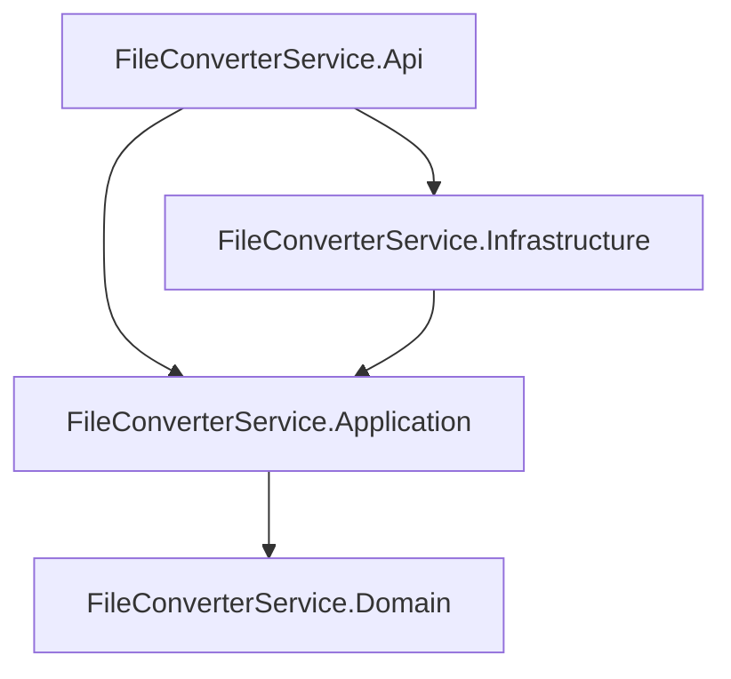
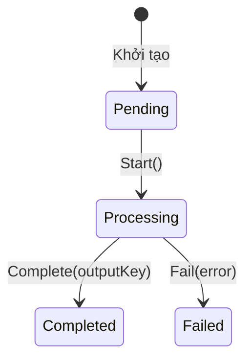
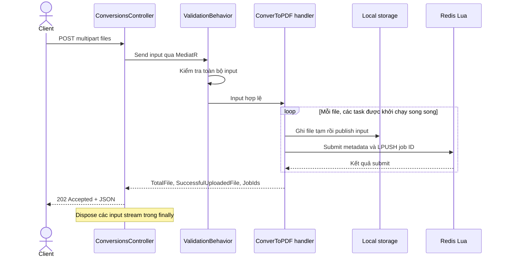
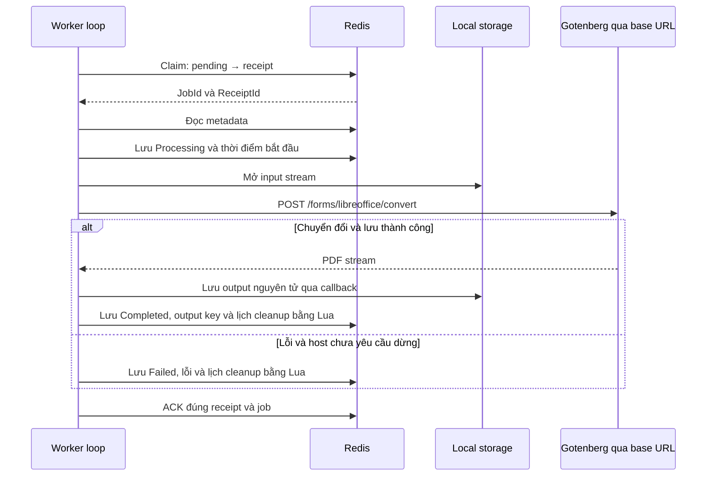
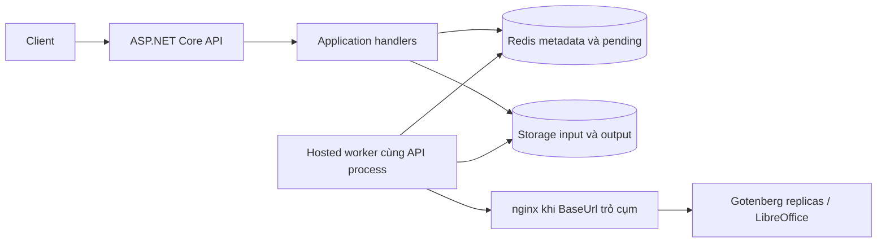

# BÁO CÁO TỔNG QUAN CẤU TRÚC VÀ CƠ CHẾ HOẠT ĐỘNG FILECONVERTER

Ngày lập: **06/11/2026**. Phạm vi: mã nguồn và cấu hình đang có trong workspace, bao gồm các thay đổi chưa commit tại thời điểm đọc.

## Mục lục

1. [Mục tiêu và phạm vi hệ thống](#1-mục-tiêu-và-phạm-vi-hệ-thống)
2. [Cấu trúc repository](#2-cấu-trúc-repository)
3. [Vai trò từng project](#3-vai-trò-từng-project)
4. [Mô hình dữ liệu và lưu trữ](#4-mô-hình-dữ-liệu-và-lưu-trữ)
5. [Khởi động, cấu hình và dependency injection](#5-khởi-động-cấu-hình-và-dependency-injection)
6. [API và các luồng nghiệp vụ](#6-api-và-các-luồng-nghiệp-vụ)
7. [Các thuật toán và cơ chế kỹ thuật](#7-các-thuật-toán-và-cơ-chế-kỹ-thuật)
8. [Hạ tầng Redis, nginx và Gotenberg](#8-hạ-tầng-redis-nginx-và-gotenberg)
9. [Xử lý lỗi và các tình huống sự cố](#9-xử-lý-lỗi-và-các-tình-huống-sự-cố)
10. [Kiểm thử và phạm vi kiểm chứng](#10-kiểm-thử-và-phạm-vi-kiểm-chứng)
11. [Đánh giá và hướng hoàn thiện](#11-đánh-giá-và-hướng-hoàn-thiện)
12. [Bản đồ mã nguồn tham khảo](#12-bản-đồ-mã-nguồn-tham-khảo)
13. [Cleanup theo thời gian lưu giữ](#13-cleanup-theo-thời-gian-lưu-giữ)

## 1. Mục tiêu và phạm vi hệ thống

FileConverter là gateway tiếp nhận tài liệu, lưu đầu vào, tạo tác vụ chuyển đổi và dùng Gotenberg/LibreOffice để tạo PDF. Client không phải giữ kết nối HTTP trong suốt thời gian chuyển đổi: client nhận mã job, tra cứu trạng thái rồi tải kết quả khi hoàn thành.

Một file tương ứng một `ConversionJob`. Một request được gửi tối đa năm file theo validator hiện tại; các file được tiếp nhận độc lập và có thể thành công một phần.

| Khả năng | Hiện trạng trong mã nguồn |
| --- | --- |
| Upload nhiều file và trả job ID | Đã triển khai, HTTP 202 |
| Chuyển đổi nền sang PDF | Đã triển khai qua hosted worker và Gotenberg |
| Tra cứu trạng thái, tải PDF, xóa tài nguyên | Đã triển khai |
| Định dạng đầu vào qua API | Validator chỉ chấp nhận hai MIME Word: DOC và DOCX |
| Queue FIFO, claim receipt, ACK | Đã triển khai bằng Redis Lua |
| Chống submit lặp cùng một job | Có fingerprint; giới hạn được phân tích tại mục 7.2 |
| Chuyển đổi sync, HTML sang PDF, ký số | Chưa có use case/endpoint tương ứng |
| Tự phục hồi receipt/job bị treo | Chưa triển khai |
| Cleanup theo TTL | Đã triển khai cho Completed/Failed; mặc định giữ 10 phút, kiểm tra mỗi 30 giây |
| Readiness kiểm tra dependency | Đã kiểm tra Redis, storage đọc/ghi/xóa và Gotenberg /health; trả 200 hoặc 503 |

Các tên tính năng, route và namespace trong báo cáo bám theo code hiện tại. Tài liệu luồng cũ trong `.agents` có cả thiết kế tương lai; không dùng các mô tả đó làm bằng chứng tính năng đã tồn tại.

## 2. Cấu trúc repository

```text
FileConverter/
├── FileConverterService/
│   ├── FileConverterService.slnx
│   ├── FileConverterService.Api/
│   │   ├── Controllers/
│   │   ├── ApiResponseModels/
│   │   ├── Middlewares/
│   │   ├── Registrations/
│   │   ├── Constants/
│   │   ├── Properties/
│   │   └── Program.cs
│   ├── FileConverterService.Application/
│   │   ├── UseCases/
│   │   │   ├── ConvertToPDF/
│   │   │   ├── GetJob/
│   │   │   ├── GetFileOfJob/
│   │   │   └── DeleteResourceRelatedToJob/
│   │   ├── Jobs/
│   │   ├── Repositories/
│   │   ├── Converters/
│   │   ├── HelperServices/Storage/
│   │   ├── Common/Behaviors/
│   │   ├── BusinessExceptions/
│   │   └── Constants/
│   ├── FileConverterService.Domain/
│   │   ├── Entities/
│   │   └── Enums/
│   └── FileConverterService.Infrastructure/
│       ├── AtomicOperations/
│       ├── Repositories/
│       ├── Converters/
│       ├── HelperServices/Storage/
│       ├── Extensions/
│       ├── Options/
│       └── Workers/
├── Redis/
│   └── docker-compose.yml
├── LibreOffice/
│   ├── Gotenberg/                 # Môi trường một container và script thử nghiệm
│   └── GotenbergCluster/          # nginx, cấu hình cụm và script thử nghiệm
├── .agents/skills/               # Hướng dẫn kiến trúc và flow
├── docs/
│   └── BAO_CAO_TONG_QUAN_DU_AN.md
└── README.md
```

`bin/`, `obj/`, file input/output thử nghiệm và dữ liệu runtime không được liệt kê chi tiết trong cây trên. `README.md` hiện chưa có nội dung giới thiệu. Các file `Class1.cs` trong Domain và Infrastructure là phần khung còn lại, không tham gia luồng nghiệp vụ được mô tả.

Solution chính chứa bốn project dịch vụ. Các project kiểm thử .NET đã được gỡ khỏi repository.

## 3. Vai trò từng project

### 3.1. Sơ đồ phụ thuộc



Đây là hướng `ProjectReference` trực tiếp trong các `.csproj`. Infrastructure sử dụng kiểu Domain thông qua phụ thuộc bắc cầu từ Application. Domain không tham chiếu project nào khác.

Kiến trúc kết hợp Clean Architecture với cách tổ chức theo use case: quy tắc trạng thái nằm trong Domain, điều phối nghiệp vụ nằm trong Application, tích hợp kỹ thuật nằm trong Infrastructure, HTTP nằm trong Api.

### 3.2. FileConverterService.Domain — mô hình nghiệp vụ

**Vai trò:** biểu diễn job và quy tắc chuyển trạng thái, không phụ thuộc ASP.NET Core, Redis hoặc HTTP client.

| Thành phần | Nội dung và vai trò |
| --- | --- |
| `Entities/ConversionJob.cs` | Thông tin file, storage key, trạng thái, thời điểm và lỗi; cung cấp `Start`, `Complete`, `Fail` |
| `Entities/ConversionJobClaim.cs` | Record bất biến chứa `JobId`, `ReceiptId`; mô tả một lần nhận job |
| `Enums/ConversionJobStatus.cs` | Các trạng thái Pending, Processing, Completed, Failed |

`ConversionJobClaim` hiện nằm trong namespace `FileConverterService.Domain.Entities`. `ReceiptId` khác `JobId`: job là tác vụ, receipt là bằng chứng của một lần giao tác vụ cho worker.

### 3.3. FileConverterService.Application — hợp đồng và use case

**Vai trò:** quyết định cần làm gì cho từng yêu cầu, thông qua interface thay vì gọi Redis/ổ đĩa/Gotenberg trực tiếp.

| Thư mục | Nội dung và vai trò |
| --- | --- |
| `UseCases/ConvertToPDF` | Input, output, validator và handler tiếp nhận upload, lưu input, submit job |
| `UseCases/GetJob` | Đọc metadata và trả trạng thái job |
| `UseCases/GetFileOfJob` | Kiểm tra hoàn thành, mở stream PDF và xác định tên tải về |
| `UseCases/DeleteResourceRelatedToJob` | Chặn xóa job đang hoạt động; xóa file và metadata của job kết thúc |
| `Jobs` | `IConversionJobAtomicOperations`: submit, claim, acknowledge |
| `Jobs/JobCleanupService` | Dùng chung cho DELETE và cleanup tự động; chỉ dọn Completed/Failed, xóa file trước metadata |
| `Repositories` | `IJobConversionRepository`: thêm, đọc, cập nhật, xóa metadata |
| `Converters` | `IDocumentConverter`: chuyển input stream sang PDF, nhận callback lưu kết quả |
| `HelperServices/Storage` | `IFileManagerService`: đọc, ghi, ghi nguyên tử, xóa và kiểm tra file |
| `Common/Behaviors` | `ValidationBehavior`: chạy FluentValidation trước handler |
| `BusinessExceptions` | Ngoại lệ nghiệp vụ cho HTTP 400/401/403/404/409 |
| `Constants` | `BussinessRuleMessage`, `ApplicationErrorMessage`: thông báo dùng chung |

Mỗi use case sử dụng `IRequest<TOutput>` và `IRequestHandler<TInput,TOutput>` của MediatR. `AssemblyReference` cung cấp điểm xác định assembly để đăng ký handler/validator bằng reflection.

Tên `ConverToPDF_*` và `BussinessRuleMessage` giữ nguyên cách viết hiện có trong mã nguồn.

### 3.4. FileConverterService.Infrastructure — hiện thực kỹ thuật

**Vai trò:** triển khai các interface của Application bằng công nghệ cụ thể, đồng thời chạy worker xử lý nền.

| Thư mục/thành phần | Vai trò |
| --- | --- |
| `Repositories/RedisJobCleanupSchedule` | Đọc Sorted Set theo hạn; xóa metadata và member bằng Lua |
| `AtomicOperations/RedisConversionJobAtomicOperations` | Lua script cho submit, claim, ACK; kiểm soát idempotency khi submit |
| `Repositories/RedisJobConversionRepository` | Đọc/ghi metadata dưới dạng Redis hash |
| `Repositories/InMemoryJobConversionRepository` | Lưu object trong `ConcurrentDictionary`; chưa được đăng ký làm repository runtime |
| `Extensions/RedisHashExtensions.*` | Ánh xạ object ↔ hash entries bằng reflection và JSON |
| `Converters/GotenbergDocumentConverter` | Multipart HTTP, retry, deadline, đọc PDF stream và gọi callback |
| `Converters/GotenbergOptions` | Địa chỉ Gotenberg, timeout, tổng deadline, số attempt, khoảng retry |
| `HelperServices/Storage/LocalFileManagerService` | Lưu trữ file trên ổ đĩa, giới hạn đường dẫn trong storage root |
| `HelperServices/Storage/StorageOptions` | Đường dẫn root lưu input/output |
| `Options/RedisOptions` | Connection string, tên Redis key, khoảng polling |
| `Workers/ConversionJobWorker` | Các vòng lặp bất đồng bộ lấy job, chuyển đổi, lưu trạng thái và ACK |
| `Workers/CleanupWorker` | Đọc cleanup set theo batch, dọn Completed/Failed hết hạn và thử lại lỗi ở vòng sau |
| `Workers/ConversionWorkerOptions` | `MaxConcurrentJobs` cho từng instance ứng dụng |

`RedisOptions` hiện nằm trong `Infrastructure.Options`; thư mục `Infrastructure/Queues` cũ không còn là vị trí của lớp này. Các options khác hiện vẫn nằm cạnh thành phần sử dụng chúng.

### 3.5. FileConverterService.Api — giao tiếp HTTP và composition root

**Vai trò:** nhận request, chuyển thành input use case, gửi qua MediatR và chuẩn hóa response; lựa chọn các implementation qua DI.

| Thành phần | Vai trò |
| --- | --- |
| `Controllers/ConversionsController` | Upload, tra cứu, download, delete |
| `Controllers/CheckController` | Endpoint health/ready |
| `ApiResponseModels` | `ApiResponse<T>`, `ApiSuccessResponse<T>`, `ApiErrorResponse` |
| `Middlewares/GlobalExceptionHandlerMiddleware` | Chuyển exception thành HTTP status và JSON lỗi; xử lý client abort |
| `Registrations` | Đăng ký use case, validator, repository, storage, Redis, converter, worker và options |
| `Program.cs` | Nạp môi trường, tạo host, đăng ký dependency, thiết lập HTTP pipeline |
| `Properties/launchSettings.json` | Profile chạy local |
| `FileConverterService.Api.http` | File hỗ trợ gọi thử API |

Response JSON có các trường `success`, `message`, `data`. Với lỗi validation/nghiệp vụ có chi tiết, `data` chứa dictionary tên trường → danh sách lỗi. Download thành công trả binary PDF, không bọc trong JSON.

## 4. Mô hình dữ liệu và lưu trữ

### 4.1. ConversionJob

| Thuộc tính | Ý nghĩa |
| --- | --- |
| `Id` | GUID định danh job |
| `OriginalFileName` | Tên file đầu vào dùng cho chuyển đổi và tên download |
| `ContentType` | MIME do request cung cấp |
| `InputStorageKey` | Đường dẫn tương đối đến file đầu vào |
| `OutputStorageKey` | Đường dẫn tương đối đến PDF, được gán khi hoàn thành |
| `Status` | Trạng thái nghiệp vụ |
| `CreatedAt` | Thời điểm tạo, UTC |
| `ProccessedAt` | Thời điểm bắt đầu xử lý, UTC; tên thuộc tính hiện viết như trong code |
| `CompletedAt` | Thời điểm hoàn thành hoặc thất bại, UTC |
| `Error` | Thông báo lỗi khi thất bại |

`GetJob_UCOutput` xuất `ProccessedAt` thành trường `ProcessedAt`. Phần lớn setter trong entity là private, riêng `ProccessedAt` có setter public; constructor không tham số hỗ trợ khôi phục object từ Redis.



Entity kiểm tra trạng thái trước mỗi chuyển đổi. Hiện chưa có nhánh retry từ Failed về Pending, trạng thái Cancelled hoặc phần trăm tiến độ. Kiểm tra trạng thái này diễn ra trên object trong bộ nhớ, chưa phải compare-and-set phân tán trong Redis.

### 4.2. Ba nhóm dữ liệu Redis

| Dữ liệu | Kiểu Redis | Tên mặc định | Nội dung |
| --- | --- | --- | --- |
| Metadata job | Hash | `fileconverter:storage:job:<guid>` | Các thuộc tính job và `_SubmissionFingerprint` |
| Pending queue | List | `fileconverter:queue` | Job ID dạng GUID `N`, không dấu gạch nối |
| Receipt đang xử lý | Hash | `fileconverter:receipt` | Field = receipt ID dạng `N`; value = job ID dạng `N` |

Metadata key được tạo bằng nội suy `job.Id`, nên GUID ở phần tên key có dấu gạch nối theo định dạng mặc định. Queue, receipt và API output dùng `ToString("N")`. Hai biểu diễn đều chỉ cùng GUID; không nên nhầm chúng khi truy vấn Redis thủ công.

`BatchKey` có trong options và được repository nhận vào, nhưng chưa có tính năng quản lý batch sử dụng nó.

Ví dụ minh họa:

```text
fileconverter:storage:job:11111111-1111-1111-1111-111111111111   [HASH]
  _SubmissionFingerprint -> A1B2...
  OriginalFileName       -> "report.docx"
  Status                 -> 0
  InputStorageKey        -> "input/<uploadGuid>.docx"
  ...

fileconverter:queue                                           [LIST]
  11111111111111111111111111111111

fileconverter:receipt                                         [HASH, sau claim]
  <receiptGuidN> -> 11111111111111111111111111111111
```

Giá trị các thuộc tính job được serialize JSON riêng từng field; chuỗi vì vậy có dấu nháy JSON. `_SubmissionFingerprint` là chuỗi hash được script ghi trực tiếp, không qua serializer từng thuộc tính.

### 4.3. Dữ liệu file trên đĩa

```text
<API ContentRootPath>/Storage/
├── input/<uploadGuidN>.<extension>
└── output/<jobGuidN>.pdf
```

File input dùng GUID riêng, không phải job ID. File tạm khi ghi có hậu tố `.<guidN>.tmp` và nằm cùng thư mục với file đích. Redis giữ metadata và mã tham chiếu, không lưu binary tài liệu/PDF.

## 5. Khởi động, cấu hình và dependency injection

### 5.1. Trình tự khởi động

1. `Env.NoClobber().Load()` nạp `.env` mà không ghi đè biến môi trường đã có.
2. `WebApplication.CreateBuilder` tạo host và hệ thống configuration.
3. Đăng ký controller, OpenAPI, MediatR, validator, middleware, hạ tầng, worker và repository.
4. Bind options từ các section `WORKER`, `REDIS`, `GOTENBERG`; thiết lập storage root từ content root.
5. `ValidateOnStart` kiểm tra các ràng buộc cấu hình khi host khởi động.
6. Thiết lập middleware exception ở đầu pipeline, OpenAPI trong Development, HTTPS redirection, authorization và route controller.
7. Hosted worker chuyển đổi và `CleanupWorker` bắt đầu xử lý nền cùng vòng đời ứng dụng.

`UseAuthorization()` có trong pipeline nhưng chưa có cấu hình authentication hoặc chính sách bảo vệ các endpoint trong code đã đọc.

### 5.2. Các đăng ký chính

| Hợp đồng | Implementation | Vòng đời/cách đăng ký |
| --- | --- | --- |
| `IFileManagerService` | `LocalFileManagerService` | Singleton |
| `IConnectionMultiplexer` | `ConnectionMultiplexer` | Singleton; kết nối theo Redis options |
| `IConversionJobAtomicOperations` | `RedisConversionJobAtomicOperations` | Singleton |
| `IJobCleanupSchedule` | `RedisJobCleanupSchedule` | Singleton |
| `IJobCleanupService` | `JobCleanupService` | Singleton |
| `IJobConversionRepository` | `RedisJobConversionRepository` | Singleton |
| `IDocumentConverter` | `GotenbergDocumentConverter` | Typed client qua `AddHttpClient` |
| Hosted worker | `ConversionJobWorker` | `AddHostedService` |
| Hosted cleanup worker | `CleanupWorker` | `AddHostedService` |
| Exception middleware | `GlobalExceptionHandlerMiddleware` | Transient |
| Handler và validator | Quét Application assembly | MediatR và FluentValidation |

Worker nhận converter qua constructor và giữ reference trong vòng đời worker. Repository in-memory không được chọn trong cấu hình DI hiện tại.

### 5.3. Cấu hình chính

| Section/tham số | Mặc định trong options hoặc cách thiết lập |
| --- | --- |
| `WORKER:MaxConcurrentJobs` | Không có giá trị dương mặc định; phải cấu hình > 0 |
| `REDIS:ConnectionString` | `localhost:6379` |
| `REDIS:QueueKey` | `fileconverter:queue` |
| `REDIS:ReceiptKey` | `fileconverter:receipt` |
| `REDIS:JobKey` | `fileconverter:storage:job` |
| `REDIS:BatchKey` | `fileconverter:storage:batch` |
| `REDIS:PollIntervalMilliseconds` | 250 ms |
| `GOTENBERG:BaseUrl` | Rỗng; phải cung cấp URL tuyệt đối |
| `GOTENBERG:TimeoutInMinutes` | 3 phút |
| `GOTENBERG:DeadlineInMinutes` | 5 phút |
| `GOTENBERG:MaxAttempts` | 1 |
| `GOTENBERG:RetryDelayInMinutes` | 0 |
| `CLEANUP:RetentionMinutes` | 10 phút tính từ `CompletedAt` |
| `CLEANUP:IntervalSeconds` | 30 giây chờ giữa các vòng cleanup |
| `CLEANUP:BatchSize` | Tối đa 100 job tới hạn mỗi vòng |
| `REDIS:CleanupKey` | `fileconverter:cleanup`, Sorted Set lưu jobId và hạn dọn |
| `StorageOptions.RootPath` | `<ContentRootPath>/Storage`, được cấu hình bằng code |

`appsettings.json` và bản Development hiện chủ yếu chứa cấu hình logging; các giá trị bắt buộc có thể được cung cấp từ môi trường hoặc `.env`. Không đưa thông tin bí mật từ cấu hình cục bộ vào báo cáo.

## 6. API và các luồng nghiệp vụ

### 6.1. Danh sách endpoint thực tế

| Method | Route | Tác dụng | Thành công |
| --- | --- | --- | --- |
| POST | `/api/conversions` | Tiếp nhận form field `files` | 202 + JSON các job ID |
| GET | `/api/conversions/job/{jobId}` | Tra cứu trạng thái | 200 + JSON metadata chọn lọc |
| GET | `/api/conversions/job/{jobId}/file` | Tải PDF | 200 + `application/pdf` |
| DELETE | `/api/conversions/job/{jobId}` | Xóa tài nguyên job kết thúc | 200 + JSON kết quả |
| GET | `/check/health` | Phản hồi liveness đơn giản | 200 + thông báo cố định |
| GET | `/check/ready` | Kiểm tra Redis, storage và Gotenberg | 200 khi đạt; 503 khi dependency lỗi |

Route hiện không có `/v1`. Upload không trả PDF trực tiếp và chưa thiết lập header `Location` trong controller.

### 6.2. Flow tiếp nhận nhiều file



**Cách triển khai:**

1. Controller mở stream từng `IFormFile`, ánh xạ thành `FileParams` gồm tên, MIME và stream.
2. Validation kiểm tra danh sách không rỗng, tối đa năm file; từng file có tên, stream khác null và MIME thuộc DOC/DOCX.
3. Handler lấy basename, giữ extension, tạo storage key bằng GUID và tạo entity Pending.
4. Mỗi file có một task lưu input nguyên tử rồi submit Redis. `Task.WhenAll` đợi các task kết thúc.
5. Handler gom job ID của task thành công. Lỗi vận hành của một file được log và có thể trả kết quả một phần; lỗi validation xảy ra trước handler sẽ chặn cả request.

Ví dụ phần `data` trong response tiếp nhận:

```json
{
  "totalFile": 2,
  "successfulUploadedFile": 1,
  "jobIds": ["11111111111111111111111111111111"]
}
```

`SuccessfulUploadedFile` chỉ đếm file đã lưu và submit thành công theo kết quả phía gọi; không có nghĩa PDF đã được tạo. Handler hiện chưa trả lỗi gắn với từng file và vẫn có thể trả 202 khi số file nhận thành công bằng 0.

### 6.3. Flow xử lý nền



Một loop chỉ nhận job tiếp theo khi xử lý xong job hiện tại. Trước conversion, worker kiểm tra job tồn tại và `job.Id` đúng với claim. Với job đã Completed/Failed, worker ACK delivery đang có rồi bỏ qua; với Processing, worker bỏ qua và giữ receipt.

Lỗi đọc/lưu metadata hoặc lỗi ACK được log ở lớp ngoài và receipt được giữ lại. Nếu host yêu cầu dừng, worker không tự đánh dấu Failed để che mất tình huống chưa rõ kết quả.

### 6.4. Flow tra cứu trạng thái

```text
GET job/{jobId}
→ Validator: GUID hợp lệ và khác Guid.Empty
→ Repository đọc hash metadata
→ Không có: 404
→ Có: ánh xạ JobId, OriginalFileName, Status,
       CreatedAt, ProcessedAt, CompletedAt, Error
→ 200 JSON
```

API cung cấp trạng thái rời rạc để client polling; chưa có phần trăm tiến độ, webhook hoặc push notification.

### 6.5. Flow tải PDF

```text
GET job/{jobId}/file
→ Validate GUID → đọc metadata
→ Job không tồn tại: 404
→ Job chưa Completed: 409
→ OutputStorageKey rỗng hoặc không còn file: 404
→ Mở output stream
→ Controller trả File(stream, "application/pdf", tên tải về)
```

Tên tải về được lấy từ basename của tên gốc và đổi extension thành `.pdf`; handler chuẩn hóa dấu phân cách trước khi lấy basename. HTTP response chịu trách nhiệm dispose stream sau khi gửi. Tải file không tự xóa job hoặc PDF.

### 6.6. Flow xóa tài nguyên

```text
DELETE job/{jobId}
→ Validate GUID → đọc metadata
→ Không tồn tại: 404
→ Pending hoặc Processing: 409
→ Xóa PDF → xóa input → xóa metadata
→ Trả JobId và Success = true
```

Nếu chưa có output key, handler vẫn thử dọn `output/<jobIdN>.pdf`, phòng trường hợp có output nhưng chưa kịp ghi metadata. Xóa file không tồn tại được storage xử lý như không có gì để xóa.

DELETE và cleanup tự động dùng chung JobCleanupService. File được xóa trước, metadata và member cleanup được xóa cùng nhau bằng Lua; không có transaction xuyên Redis và filesystem. Nếu bị gián đoạn, có thể còn một phần tài nguyên. API không triển khai hủy job đang chạy và thao tác delete hiện không dọn receipt tồn đọng do ACK lỗi.

### 6.7. Flow validation và xử lý ngoại lệ

`ValidationBehavior` gọi các validator, gom lỗi theo tên thuộc tính rồi ném `BadRequestException`. Handler chỉ chạy khi không có lỗi.

| Tình huống | HTTP status do middleware ánh xạ |
| --- | --- |
| BadRequestException | 400 |
| UnauthorizedException | 401 |
| ForbiddenException | 403 |
| NotFoundException | 404 |
| ConflictUniqueValueException | 409 |
| Exception chưa được phân loại | 500 |
| OperationCanceledException và RequestAborted đã hủy | Gán 499 nếu response chưa bắt đầu |

499 ở đây là cách ghi nhận phía server; client đã ngắt kết nối có thể không nhận được response. Lỗi model binding do framework xử lý có thể có định dạng riêng vì chưa thấy cấu hình thay thế response mặc định của `[ApiController]`.

## 7. Các thuật toán và cơ chế kỹ thuật

### 7.1. Queue FIFO bằng LPUSH/RPOP

Producer thêm bên trái bằng `LPUSH`, consumer lấy bên phải bằng `RPOP`:

```text
Submit A: [A]
Submit B: [B, A]
Submit C: [C, B, A]
Claim:    A → B → C
```

Đây là FIFO theo thứ tự submit script thực sự được Redis thực thi. Trong một request nhiều file, các task chạy song song nên thứ tự vào queue có thể khác thứ tự file trong request. FIFO cũng không có nghĩa thứ tự hoàn thành giống thứ tự nhận, vì nhiều loop xử lý đồng thời.

Khi queue rỗng, `ClaimAsync` chờ `PollIntervalMilliseconds` rồi thử lại; không dùng blocking pop. Khi Redis claim gặp lỗi, worker log và chờ ba giây trước khi thử lại.

### 7.2. Submit nguyên tử và fingerprint SHA-256

Fingerprint được tính như sau:

```text
JSON { Id, OriginalFileName, ContentType, InputStorageKey, CreatedAt }
→ UTF-8 bytes
→ SHA-256
→ Chuỗi hexadecimal
```

Fingerprint xác định bộ metadata của lần submit, không phải hash nội dung file. Một HTTP upload mới tạo job ID và thời điểm mới nên không được tự gộp với upload trước dù binary giống nhau. Cơ chế này cũng không phải chữ ký xác thực.

Thuật toán Lua:

```text
Kiểm tra kiểu job key và queue key
Kiểm tra danh sách field/value hợp lệ
Nếu metadata đã tồn tại:
    Không có fingerprint → trả -2
    Fingerprint khác     → trả -1
    Fingerprint giống    → trả 0, không enqueue lại
Nếu chưa tồn tại:
    HSET metadata và fingerprint
    LPUSH job ID
    Nếu LPUSH báo lỗi: xóa hash vừa tạo, trả lỗi
    Nếu thành công: trả 1
```

| Kết quả | Ý nghĩa phía C# |
| --- | --- |
| `1` | Tạo job và enqueue lần đầu |
| `0` | Đã submit cùng metadata; không enqueue thêm |
| `-1` | Ném lỗi: cùng job ID nhưng dữ liệu submit khác |
| `-2` | Ném lỗi: có metadata nhưng thiếu bằng chứng submit, cần reconciliation |

Lua bảo đảm các lệnh trong script không bị client khác xen ngang. Tuy nhiên, Lua Redis không tự rollback mọi thay đổi nếu có lỗi runtime; code chủ động dùng `pcall` và xóa hash mới khi LPUSH thất bại.

File input được lưu trước Lua nên toàn bộ quá trình filesystem + Redis không phải một transaction. Nếu mất phản hồi Redis, client có thể không biết script đã thành công hay chưa; handler giữ input để tránh xóa file mà worker đã có thể sử dụng. Hiện chưa có tiến trình reconciliation xử lý các trường hợp này.

Tính idempotent tồn tại khi metadata còn được giữ. Nếu metadata bị xóa, cùng job có thể được xem như submit mới; script cũng không tự enqueue lại một job đã có fingerprint nếu queue bị mất riêng lẻ.

### 7.3. Truyền KEYS và ARGV cho Lua

```csharp
ScriptEvaluateAsync(SubmitScript, [jobKey, queueKey], arguments);
```

```text
KEYS[1] = Redis key của hash metadata
KEYS[2] = Redis key của list pending

ARGV[1] = job ID để enqueue
ARGV[2] = fingerprint
ARGV[3] = tên field thứ nhất
ARGV[4] = giá trị field thứ nhất
ARGV[5] = tên field thứ hai
ARGV[6] = giá trị field thứ hai
...
```

Lua đánh chỉ số từ 1. `KEYS` chứa tên Redis key; `ARGV` chứa tham số dữ liệu, gồm cả tên field bên trong hash.

Dòng ghi hash:

```lua
redis.call('HSET', KEYS[1], '_SubmissionFingerprint', ARGV[2], unpack(ARGV, 3))
```

Ví dụ viết tường minh:

```lua
redis.call(
    'HSET',
    'fileconverter:storage:job:<guid>',
    '_SubmissionFingerprint', 'A1B2...',
    'OriginalFileName', '"report.docx"',
    'Status', '0'
)
```

`unpack(ARGV, 3)` trải các cặp field/value từ phần tử thứ ba. `HSET` thêm field mới hoặc ghi đè field đã có, không xóa các field khác.

### 7.4. Claim nguyên tử bằng receipt

```text
Sinh receipt ID mới
→ LINDEX pending -1 để xem job cuối list
→ Nếu rỗng: chưa claim, chờ polling
→ Kiểm tra receipt ID chưa có
→ HSET receipts[receiptId] = jobId
→ RPOP pending
→ Trả ConversionJobClaim(jobId, receiptId)
```

Việc ghi receipt trước khi bỏ phần tử pending giúp giữ dấu vết delivery trong lần thực thi script bình thường. Tính nguyên tử ngăn hai consumer cùng lấy một phần tử queue, nhưng không ngăn cùng job ID xuất hiện nhiều lần trong queue và không chứng minh conversion chỉ chạy đúng một lần.

Receipt hiện chỉ lưu ánh xạ ID, không có worker owner, thời điểm, lease hoặc heartbeat. Vì vậy claim/ACK hiện là nền tảng theo dõi delivery, chưa phải cơ chế tự phục hồi hoàn chỉnh.

### 7.5. ACK có điều kiện

```lua
if redis.call('HGET', KEYS[1], ARGV[1]) == ARGV[2] then
    return redis.call('HDEL', KEYS[1], ARGV[1])
end
return 0
```

`ARGV[1]` là receipt ID, `ARGV[2]` là job ID. Chỉ xóa receipt nếu value khớp job. ACK lặp hoặc ACK sai cặp không xóa receipt khác. Implementation hiện không trả số field bị xóa cho caller.

ACK không xóa metadata hoặc file. Worker chủ động giữ thứ tự **lưu output → lưu trạng thái cuối → ACK** để tránh xác nhận quá sớm.

### 7.6. Giới hạn concurrency bằng các async loop cố định

Worker tạo `MaxConcurrentJobs` loop với `Enumerable.Range`, rồi đợi bằng `Task.WhenAll`. Mỗi loop claim một job và xử lý xong mới claim tiếp.

```text
Instance có C loop → tối đa C job nằm trong các bước xử lý của worker đó
R instance, mỗi instance C loop → tối đa R × C job ở các loop
```

Đây là concurrency bất đồng bộ, không phải tạo C thread chuyên dụng. Cách làm không prefetch cả batch về bộ nhớ. Giới hạn này áp dụng cho từng process, không phải quota toàn cụm.

Nếu có N container, throughput còn phụ thuộc thời gian convert, tài nguyên CPU/RAM, I/O và phân phối request. Chỉ có thể dùng `N / thời gian xử lý trung bình` như ước lượng lý tưởng khi mỗi node chạy một job, tải cân bằng và không có nghẽn khác; báo cáo không coi đó là số đo hiệu năng.

### 7.7. Ghi file nguyên tử bằng tệp tạm và rename

```text
Resolve đường dẫn trong storage root
→ Tạo tên tạm cùng thư mục đích
→ Copy stream vào file tạm bằng I/O async
→ Đóng handle file tạm
→ Kiểm tra cancellation
→ File.Move(temp, final, overwrite: true)
→ finally xóa file tạm nếu còn
```

Đặt file tạm cùng thư mục giúp bước publish dùng rename trên cùng filesystem. Khi hủy trong lúc copy, file đích cũ được giữ nguyên và file tạm được dọn trong nhánh `finally` khi process còn hoạt động. Process bị kill đột ngột vẫn có thể để lại file tạm.

Nguyên tử ở đây nói đến việc công bố tên file hoàn chỉnh; code chưa thực hiện giao thức bảo đảm bền vững tuyệt đối khi mất điện hoặc transaction chung với Redis.

`ResolvePath` chuẩn hóa đường dẫn bằng `GetFullPath` rồi kiểm tra nó nằm dưới root. Đây là kiểm tra đường dẫn dạng chuỗi; chưa có cơ chế riêng xử lý symlink/reparse point. Buffer `FileStream` được cấu hình 64 KiB, nhưng không thể suy ra toàn hệ thống chỉ dùng từng đó bộ nhớ: model binding `IFormFile`, multipart, proxy và các request đồng thời có chi phí riêng.

### 7.8. Ánh xạ entity ↔ Redis hash

**Ghi:** reflection lấy public property có getter, bỏ indexer; serialize từng value theo kiểu property thành JSON; tạo `HashEntry(propertyName, jsonValue)`.

**Đọc:** `HGETALL`, tạo object qua constructor không tham số, tìm property có setter kể cả private, deserialize theo kiểu property rồi gán bằng reflection. Field không ánh xạ tới property như `_SubmissionFingerprint` được bỏ qua khi khôi phục entity.

Repository update ghi các field nhưng không xóa field bổ sung, nên fingerprint vẫn còn. Đổi tên/kiểu thuộc tính Domain có thể ảnh hưởng dữ liệu Redis đã lưu; hiện chưa có schema version hoặc migration. Reflection cũng có thể khôi phục trạng thái mà không đi qua `Start/Complete/Fail`, nên dữ liệu lưu trữ cần được xem là một ranh giới kiểm tra riêng.

### 7.9. HTTP conversion, retry và deadline

Converter gửi multipart field `files` tới `/forms/libreoffice/convert`, dùng `ResponseHeadersRead` để nhận stream body rồi chuyển cho callback lưu output.

| Tình huống | Xử lý hiện tại |
| --- | --- |
| Input hỗ trợ seek | Có thể thử lại tới `MaxAttempts`; reset về vị trí ban đầu trước mỗi attempt |
| Input không seek | Chỉ một attempt |
| HTTP từ 500 trở lên, còn attempt | Dispose response, chờ delay cố định rồi gửi lại |
| HttpRequestException, còn attempt | Chờ rồi gửi lại |
| TaskCanceledException do timeout attempt, token tổng chưa hủy, còn attempt | Chờ rồi gửi lại |
| HTTP 4xx hoặc response lỗi cuối | `EnsureSuccessStatusCode` gây lỗi; worker đánh dấu Failed |
| Lỗi đọc PDF body hoặc callback lưu output | Không nằm trong vòng retry gửi request; lỗi chuyển về worker |
| Hết deadline tổng | Chuyển thành TimeoutException khi token của caller chưa hủy |

Delay retry là cố định, đơn vị phút; chưa có exponential backoff hoặc jitter. `LeaveOpenReadStream` giúp dispose multipart content mà không đóng input gốc giữa các attempt.

`HttpClient.Timeout` giới hạn phần `SendAsync` đến lúc nhận headers khi dùng `ResponseHeadersRead`; deadline token tổng bao trùm cả retry, delay, đọc PDF và callback lưu file. Các timeout của nginx/Gotenberg là lớp cấu hình khác và cần được đối chiếu khi vận hành.

Timeout/lỗi mạng phía caller không chứng minh engine đã dừng. Khi tăng số attempt, có thể gửi conversion mới trong lúc attempt trước chưa rõ kết quả. Mặc định `MaxAttempts = 1` chỉ là mặc định lớp options, không khẳng định giá trị runtime từ môi trường.

### 7.10. Ranh giới cancellation

| Giai đoạn | Hành vi |
| --- | --- |
| Trước hoặc trong lúc lưu input | Tôn trọng token của request; atomic save dọn file tạm khi có thể |
| Sau lưu input nhưng trước submit | Kiểm tra token; nếu hủy thì thử xóa input |
| Khi đã bắt đầu submit từ upload handler | Dùng `CancellationToken.None`, đợi thao tác Redis thay vì bỏ ngang |
| Submit lỗi, chưa rõ Redis đã nhận chưa | Giữ input, log lỗi để phục vụ reconciliation |
| Sau khi job được tiếp nhận | Worker dùng token vòng đời host; client disconnect không hủy job đã nhận |
| Claim/ACK đã phát lệnh Redis | Đợi lệnh hoàn tất; kiểm tra cancellation trước khi phát lệnh |
| Host dừng trong conversion | Hủy I/O theo token; có thể để Processing và receipt cần phục hồi |

Repository metadata vẫn có các thao tác dùng `WaitAsync(token)`; vì vậy không phải mọi mutation trong dự án đều có cùng chính sách cancellation như submit/claim/ACK.

## 8. Hạ tầng Redis, nginx và Gotenberg

### 8.1. Sơ đồ runtime



Converter chỉ biết `GOTENBERG:BaseUrl`; có thể trỏ tới một Gotenberg hoặc nginx. Cấu hình compose không tự quyết định BaseUrl đang được ứng dụng sử dụng.

### 8.2. Redis

`Redis/docker-compose.yml` khai báo Redis image `7.4-alpine3.21`, cổng host 6379, volume `/data` và bật AOF. RedisInsight phục vụ quan sát dữ liệu qua cổng 5540.

AOF/volume là cấu hình persistence; không thay thế recovery job trong application hoặc chứng minh không mất dữ liệu ở mọi kiểu sự cố. Chưa có mô hình Redis Cluster trong compose này. Nếu chuyển sang Redis Cluster, các key trong cùng Lua script phải chung hash slot; tên mặc định hiện chưa dùng hash tag để bảo đảm điều đó.

### 8.3. Môi trường Gotenberg đơn

`LibreOffice/Gotenberg/docker-compose.yml` khai báo một container, publish cổng 3000, `--api-timeout=10s`, `--libreoffice-restart-after=1`, health check `/health`, giới hạn cấu hình 0.25 CPU và 512 MiB RAM. Đây là môi trường thử riêng, không đồng nhất với cấu hình cụm.

### 8.4. Cụm Gotenberg qua nginx

Compose cụm khai báo:

| Thành phần | Cấu hình trong repository |
| --- | --- |
| nginx | `nginx:1.28-alpine`, host 80 → container 3000 |
| Gotenberg | `gotenberg/gotenberg:8` |
| Replica mong muốn | 20 trong `deploy.replicas` |
| API timeout engine | 180 giây |
| LibreOffice restart | Cấu hình restart sau một conversion |
| Tài nguyên mỗi replica | Giới hạn 0.25 CPU, 512m bộ nhớ |

Đây là giá trị khai báo trong compose. Image tag major `8` chưa cố định patch/digest; báo cáo không suy ra phiên bản LibreOffice thực tế từ tag này.

### 8.5. Thuật toán và chính sách proxy

| Cấu hình nginx | Vai trò |
| --- | --- |
| `least_conn` | Chọn upstream theo số kết nối đang hoạt động |
| `zone gotenberg_pool 64k` | Shared state upstream giữa nginx worker process trong instance |
| Docker DNS resolver, `resolve` | Cập nhật địa chỉ upstream theo DNS |
| `max_fails=1 fail_timeout=10s` | Chính sách lỗi thụ động của upstream |
| `client_max_body_size 100m` | Giới hạn body trên nginx, không phải validation toàn bộ API gateway |
| `proxy_request_buffering on` | Buffer request body trước khi chuyển upstream |
| `proxy_buffering off` | Không buffer response theo cơ chế proxy buffering thông thường |
| `proxy_ignore_client_abort on` | Không chủ động bỏ upstream chỉ vì client ngắt kết nối |
| `proxy_next_upstream off` | Không tự replay conversion sang upstream khác |
| Proxy connect/send/read timeout | 300 giây theo cấu hình |
| `/nginx-health` | Liveness của nginx, không chứng minh Gotenberg rảnh |

`least_conn` phân phối request theo số kết nối đang hoạt động tới các upstream. Giới hạn concurrency của worker được cấu hình riêng bằng `WORKER:MaxConcurrentJobs`.

Việc nginx giữ upstream khi client abort cũng không xác nhận conversion đã dừng khi timeout hoặc nginx restart. Retry trong converter là lớp riêng, vẫn có thể phát request mới dù nginx đã tắt upstream replay.

## 9. Xử lý lỗi và các tình huống sự cố

| Điểm xảy ra sự cố | Trạng thái có thể còn lại | Hành vi và giới hạn hiện tại |
| --- | --- | --- |
| Copy input lỗi/hủy | File tạm | `finally` thử dọn; kill process có thể để lại temp |
| Input đã lưu, process chết trước submit | Input không có metadata | Chưa có orphan cleanup |
| Redis submit thành công nhưng mất phản hồi | Metadata/queue có thể đã có, input còn | Caller có thể ghi nhận thất bại; chưa có reconciliation trả lại job ID |
| Worker chết sau claim | Receipt còn, pending đã mất phần tử | Không có automatic requeue |
| Worker chết sau lưu Processing | Metadata Processing, receipt còn | Job có thể treo vô thời hạn |
| Conversion lỗi khi host vẫn chạy | Failed được ghi nếu Redis hoạt động | Worker ACK sau lưu trạng thái |
| Timeout nhưng engine còn chạy | Metadata có thể Failed, engine chưa rõ kết quả | Retry chưa có phối hợp trạng thái attempt/node |
| PDF lưu xong nhưng lưu Completed lỗi | PDF tồn tại, metadata có thể Processing | Chưa có đối chiếu output để phục hồi |
| Lưu trạng thái cuối xong nhưng ACK lỗi | Completed/Failed và receipt còn | Worker giữ receipt; chưa có quét tự động receipt tồn đọng |
| Xóa dở dang | Một phần file/metadata còn | Giữ metadata và member cleanup để thử lại; xóa file trước rồi dọn Redis bằng Lua |
| API/worker chạy trên nhiều host | Redis chung nhưng file có thể chỉ ở một host | Cần storage dùng chung hoặc cơ chế truy cập file phù hợp |

`RedisJobConversionRepository.UpdateAsync` kiểm tra key tồn tại rồi ghi ở hai thao tác riêng. Chưa có version/owner/CAS cho chuyển trạng thái, nên không bảo vệ trước cạnh tranh ghi nếu sau này có redelivery/recovery hoặc duplicate delivery.

Middleware và trạng thái Failed hiện có thể trả/lưu `exception.Message` từ lỗi kỹ thuật. Cần cân nhắc thông báo công khai ổn định và giữ chi tiết nội bộ trong log khi hoàn thiện vận hành.

## 10. Kiểm thử và phạm vi kiểm chứng

### 10.1. Kiểm tra .NET

Các project kiểm thử .NET đã được gỡ. Có thể kiểm tra build bằng lệnh:

```powershell
dotnet build FileConverterService/FileConverterService.slnx
```

### 10.2. Các script Node.js thử nghiệm

| Script | Mục đích/cách hoạt động đang có |
| --- | --- |
| `Gotenberg/test-cancel.cjs` | Gọi Gotenberg đơn; có tùy chọn abort nhưng hiện `CANCEL_AFTER_MS = null` |
| `Gotenberg/test-timeout.cjs` | Chỉ in hướng dẫn đổi timeout và chạy lại script cancel; chưa tự thực hiện kiểm thử |
| `GotenbergCluster/test-client-abort.cjs` | Gọi nginx trực tiếp, có request abort sau 5 giây và request gửi sau 10 giây |
| `GotenbergCluster/test-upstream-timeout.cjs` | Gọi nginx trực tiếp với file dài/ngắn; hướng dẫn đổi engine timeout về 20 giây trước khi chạy |
| `GotenbergCluster/test-capacity.cjs` | Gửi 25 request upload đồng thời vào API `/api/conversions` |

**Giới hạn quan trọng của `test-capacity.cjs`:** API upload trả JSON 202, nhưng script đọc response bằng `arrayBuffer()` và ghi thành `.pdf`. File có phần mở rộng PDF trong trường hợp này thực chất là body JSON tiếp nhận, không phải kết quả conversion. Thời gian script đo chủ yếu là bước upload/acceptance, chưa phải thời gian tạo PDF của cả batch.

Để kiểm thử end-to-end cần: parse JSON → lấy job ID → polling tới Completed/Failed có deadline → tải `/job/{id}/file` → kiểm tra status/content và đối chiếu log thực thi từng node. Đo thời gian response upload hoặc số file đuôi `.pdf` không chứng minh được concurrency engine.

Các script dùng đường dẫn tương đối và có thao tác xóa thư mục output trước khi chạy. Báo cáo chỉ phân tích mã, không chạy các script hạ tầng này. Nhãn thời gian trong một số script ghi `ms` nhưng biểu thức chia 1000 thực tế cho đơn vị giây.

### 10.3. Kết quả kiểm chứng khi lập báo cáo

- Build solution: thành công, 0 warning và 0 error.

## 11. Đánh giá và hướng hoàn thiện

### 11.1. Các điểm đã có nền tảng tốt

- Phân tầng và interface tách nghiệp vụ khỏi Redis, HTTP và filesystem.
- Use case có input/output/validator riêng, thuận tiện theo dõi tính năng.
- Submit metadata và enqueue được gom trong Lua, có xử lý submit lặp và lỗi LPUSH.
- Claim có receipt; ACK kiểm tra đúng cặp receipt/job và diễn ra sau persist trạng thái cuối.
- Worker giới hạn concurrency trong từng instance, không lấy trước một batch lớn.
- File input/output được publish qua file tạm; stream có cơ chế quản lý vòng đời rõ ở controller/converter.
- Có tổng deadline cho cả nhận PDF và lưu output, thay vì chỉ timeout chờ response headers.

### 11.2. Các hạng mục cần hoàn thiện

| Ưu tiên | Hạng mục | Hướng triển khai đề xuất, chưa được thực hiện trong báo cáo |
| --- | --- | --- |
| Cao | Recovery job/receipt | Thêm owner, attempt, thời điểm, heartbeat; tiến trình reconciliation phối hợp với trạng thái thực thi engine |
| Cao | Ghi trạng thái có điều kiện | CAS theo state/version/attempt/owner; chặn attempt cũ ghi kết quả của attempt mới |
| Cao | Storage khi scale | Shared volume hoặc implementation storage chung mà mọi worker truy cập được |
| Trung bình | Validation file | Chưa có kiểm tra size/tổng request, file rỗng, extension và nội dung thực |
| Trung bình | Hợp đồng upload | Trả kết quả từng file, phân biệt rejected/accepted/unknown, xử lý trường hợp không file nào được nhận |
| Trung bình | Cleanup mở rộng | Đã có retention/retry cho job kết thúc; còn cần dọn orphan/temp và phối hợp job bị treo |
| Đã triển khai | Readiness | Redis PING, probe file input/output, Gotenberg /health; deadline cấu hình qua READINESS__TimeoutSeconds |
| Trung bình | Quan sát hệ thống | Pending depth, receipt age, thời gian queue/convert/save, lỗi và tải xử lý của cụm |
| Trung bình | Kiểm thử | Redis integration cho Lua, worker lifecycle/failure, download/delete, E2E conversion và kiểm thử tải |
| Thấp | Đồng bộ tài liệu | README, route hiện tại, cây thư mục, tên lớp và phân biệt thiết kế tương lai |

### 11.3. Chênh lệch với tài liệu thiết kế trước đây

| Nội dung tài liệu cũ | Mã nguồn/cấu hình hiện tại |
| --- | --- |
| Route `/api/v1/conversions` | `/api/conversions`, có đoạn `/job/{jobId}` |
| Sync conversion/ký tức thì | Chưa có endpoint/use case |
| Cleanup TTL 60 phút | Đã có CleanupWorker; mặc định hiện tại 10 phút, cấu hình qua CLEANUP |
| Bốn worker cố định | Số loop theo `WORKER:MaxConcurrentJobs` |
| Bốn container engine | Compose cụm khai báo 20 replica; chưa xác nhận runtime |
| RPOPLPUSH và tự khôi phục khi restart | Lua claim vào receipt hash; chưa có recovery |
| Request streaming không buffer toàn tuyến | `IFormFile` ở API và `proxy_request_buffering on` ở nginx |
| Nhận toàn bộ Office | Validator hiện chỉ nhận MIME DOC/DOCX |

Các số RAM, thời gian chuyển đổi hoặc bảo đảm không mất job trong tài liệu cũ chưa được xác nhận bằng kết quả kiểm thử của lần lập báo cáo này.

## 12. Bản đồ mã nguồn tham khảo

Các liên kết dưới đây trỏ tới mã nguồn tương đối từ thư mục `docs`:

| Nội dung cần đọc | File |
| --- | --- |
| Entry point | [Program.cs](../FileConverterService/FileConverterService.Api/Program.cs) |
| API chuyển đổi | [ConversionsController.cs](../FileConverterService/FileConverterService.Api/Controllers/ConversionsController.cs) |
| Health/ready | [CheckController.cs](../FileConverterService/FileConverterService.Api/Controllers/CheckController.cs) |
| Exception middleware | [GlobalExceptionHandlerMiddleware.cs](../FileConverterService/FileConverterService.Api/Middlewares/GlobalExceptionHandlerMiddleware.cs) |
| Validation pipeline | [ValidationBehavior.cs](../FileConverterService/FileConverterService.Application/Common/Behaviors/ValidationBehavior.cs) |
| Tiếp nhận upload | [ConverToPDF_UCHandler.cs](../FileConverterService/FileConverterService.Application/UseCases/ConvertToPDF/ConverToPDF_UCHandler.cs) |
| Quy tắc file | [ConverToPDF_UCInputValidator.cs](../FileConverterService/FileConverterService.Application/UseCases/ConvertToPDF/ConverToPDF_UCInputValidator.cs) |
| Tra cứu | [GetJob_UCHandler.cs](../FileConverterService/FileConverterService.Application/UseCases/GetJob/GetJob_UCHandler.cs) |
| Download | [GetFileOfJob_UCHandler.cs](../FileConverterService/FileConverterService.Application/UseCases/GetFileOfJob/GetFileOfJob_UCHandler.cs) |
| Cleanup thủ công | [DeleteResourceRelatedToJob_UCHandler.cs](../FileConverterService/FileConverterService.Application/UseCases/DeleteResourceRelatedToJob/DeleteResourceRelatedToJob_UCHandler.cs) |
| Entity và claim | [ConversionJob.cs](../FileConverterService/FileConverterService.Domain/Entities/ConversionJob.cs), [ConversionJobClaim.cs](../FileConverterService/FileConverterService.Domain/Entities/ConversionJobClaim.cs) |
| Hợp đồng atomic operations | [IConversionJobAtomicOperations.cs](../FileConverterService/FileConverterService.Application/Jobs/IConversionJobAtomicOperations.cs) |
| Thuật toán Lua | [RedisConversionJobAtomicOperations.cs](../FileConverterService/FileConverterService.Infrastructure/AtomicOperations/RedisConversionJobAtomicOperations.cs) |
| Redis metadata | [RedisJobConversionRepository.cs](../FileConverterService/FileConverterService.Infrastructure/Repositories/RedisJobConversionRepository.cs) |
| Redis options | [RedisOptions.cs](../FileConverterService/FileConverterService.Infrastructure/Options/RedisOptions.cs) |
| Worker | [ConversionJobWorker.cs](../FileConverterService/FileConverterService.Infrastructure/Workers/ConversionJobWorker.cs) |
| Retry/deadline | [GotenbergDocumentConverter.cs](../FileConverterService/FileConverterService.Infrastructure/Converters/GotenbergDocumentConverter.cs) |
| File storage | [LocalFileManagerService.cs](../FileConverterService/FileConverterService.Infrastructure/HelperServices/Storage/LocalFileManagerService.cs) |
| Cụm engine | [docker-compose.yml](../LibreOffice/GotenbergCluster/docker-compose.yml), [nginx.conf](../LibreOffice/GotenbergCluster/nginx.conf) |
| Redis deployment | [docker-compose.yml](../Redis/docker-compose.yml) |
| Script upload đồng thời | [test-capacity.cjs](../LibreOffice/GotenbergCluster/test-capacity.cjs) |
| Luồng thiết kế cũ để đối chiếu | [all-flow.md](../.agents/skills/api-service-flow-logic-skills/references/flows/all-flow.md) |

## 13. Cleanup theo thời gian lưu giữ

Chi tiết implementation, cấu hình, Sorted Set, retry và phạm vi kiểm chứng nằm tại [CLEANUP.md](CLEANUP.md). Mặc định giữ tài nguyên 10 phút sau CompletedAt; CleanupWorker đọc tối đa 100 job tới hạn từ Sorted Set và chờ 30 giây sau mỗi batch. DELETE thủ công vẫn chỉ yêu cầu Completed/Failed và không đợi hết hạn.

## 14. Readiness

`GET /check/ready` kiểm tra đồng thời Redis PING, ghi nguyên tử/đọc/xóa file thử trong input và output, và HTTP GET /health trên GOTENBERG:BaseUrl. Thành công trả ApiSuccessResponse chứa checks và ready; lỗi dependency trả 503 ApiErrorResponse với tên dependency lỗi, không lộ exception kỹ thuật. READINESS__TimeoutSeconds trong .env mặc định 5 giây. Deadline hỗ trợ cancellation cho I/O bất đồng bộ; thao tác filesystem đồng bộ và dọn file probe không phải timeout cưỡng bức. Nếu BaseUrl trỏ nginx, health chỉ phản ánh upstream được chọn, chưa xác nhận mọi replica. Health không chứng minh engine còn capacity. /check/health vẫn là liveness đơn giản. Kiểm thử dùng Redis thật, storage thật và HTTP handler giả lập cho Gotenberg; đã kiểm tra 200/503, lỗi dependency, timeout và cancellation.

